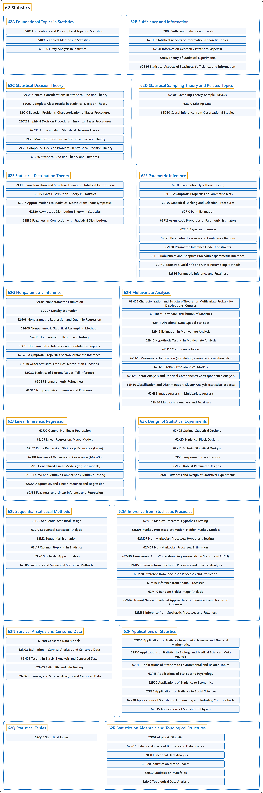

# 62 Statistics

## Classification

## Glossary

| Term | Definition | 中文翻译 | Source |
|---|---|---|---|
| **62 Statistics** 统计 | "The mathematical study of the **likelihood and probability of events** occurring based on known information and inferred by **taking a limited number of samples**." | 对事件发生的**可能性和概率**所作的数学研究，依据已知信息，并通过**抽取有限数量的样本**来推断。 | [Weisstein, n.d., "Statistics" entry, para. 1](https://mathworld.wolfram.com/Statistics.html#:~:text=The%20mathematical%20study%20of%20the%20likelihood%20and%20probability%20of%20events) |
| **[62A Foundational Topics in Statistics](62a-foundational-topics-in-statistics.md)** 统计学基础专题 | (No definition) | （无定义） | [Associate Editors of Mathematical Reviews and zbMATH, 2020](https://msc2020.org/) |
| **[62B Sufficiency and Information](62b-sufficiency-and-information.md)** 充分性与信息 | (No definition) | （无定义） | [Associate Editors of Mathematical Reviews and zbMATH, 2020](https://msc2020.org/) |
| **[62C Statistical Decision Theory](62c-statistical-decision-theory.md)** 统计决策理论 | (No definition) | （无定义） | [Associate Editors of Mathematical Reviews and zbMATH, 2020](https://msc2020.org/) |
| **[62D Statistical Sampling Theory and Related Topics](62d-statistical-sampling-theory-and-related-topics.md)** 统计抽样理论及相关专题 | (No definition) | （无定义） | [Associate Editors of Mathematical Reviews and zbMATH, 2020](https://msc2020.org/) |
| **[62E Statistical Distribution Theory](62e-statistical-distribution-theory.md)** 统计分布理论 | (No definition) | （无定义） | [Associate Editors of Mathematical Reviews and zbMATH, 2020](https://msc2020.org/) |
| **[62F Parametric Inference](62f-parametric-inference.md)** 参数推断 | (No definition) | （无定义） | [Associate Editors of Mathematical Reviews and zbMATH, 2020](https://msc2020.org/) |
| **[62G Nonparametric Inference](62g-nonparametric-inference.md)** 非参数推断 | (No definition) | （无定义） | [Associate Editors of Mathematical Reviews and zbMATH, 2020](https://msc2020.org/) |
| **[62H Multivariate Analysis](62h-multivariate-analysis.md)** 多元分析 | (No definition) | （无定义） | [Associate Editors of Mathematical Reviews and zbMATH, 2020](https://msc2020.org/) |
| **[62J Linear Inference, Regression](62j-linear-inference-regression.md)** 线性推断、回归 | (No definition) | （无定义） | [Associate Editors of Mathematical Reviews and zbMATH, 2020](https://msc2020.org/) |
| **[62K Design of Statistical Experiments](62k-design-of-statistical-experiments.md)** 统计试验设计 | (No definition) | （无定义） | [Associate Editors of Mathematical Reviews and zbMATH, 2020](https://msc2020.org/) |
| **[62L Sequential Statistical Methods](62l-sequential-statistical-methods.md)** 序贯统计方法 | (No definition) | （无定义） | [Associate Editors of Mathematical Reviews and zbMATH, 2020](https://msc2020.org/) |
| **[62M Inference from Stochastic Processes](62m-inference-from-stochastic-processes.md)** 随机过程的推断 | (No definition) | （无定义） | [Associate Editors of Mathematical Reviews and zbMATH, 2020](https://msc2020.org/) |
| **[62N Survival Analysis and Censored Data](62n-survival-analysis-and-censored-data.md)** 生存分析与删失数据 | (No definition) | （无定义） | [Associate Editors of Mathematical Reviews and zbMATH, 2020](https://msc2020.org/) |
| **[62P Applications of Statistics](62p-applications-of-statistics.md)** 统计学的应用 | (No definition) | （无定义） | [Associate Editors of Mathematical Reviews and zbMATH, 2020](https://msc2020.org/) |
| **[62Q Statistical Tables](62q-statistical-tables.md)** 统计表 | (No definition) | （无定义） | [Associate Editors of Mathematical Reviews and zbMATH, 2020](https://msc2020.org/) |
| **[62R Statistics on Algebraic and Topological Structures](62r-statistics-on-algebraic-and-topological-structures.md)** 代数与拓扑结构上的统计 | (No definition) | （无定义） | [Associate Editors of Mathematical Reviews and zbMATH, 2020](https://msc2020.org/) |

## References

Associate Editors of Mathematical Reviews and zbMATH. (2020). *MSC2020: Mathematics Subject Classification system*. Retrieved October 27, 2026, from <https://msc2020.org/>

Weisstein, E. W. (n.d.). *Statistics*. MathWorld: A Wolfram Resource. Retrieved October 27, 2026, from <https://mathworld.wolfram.com/Statistics.html>
