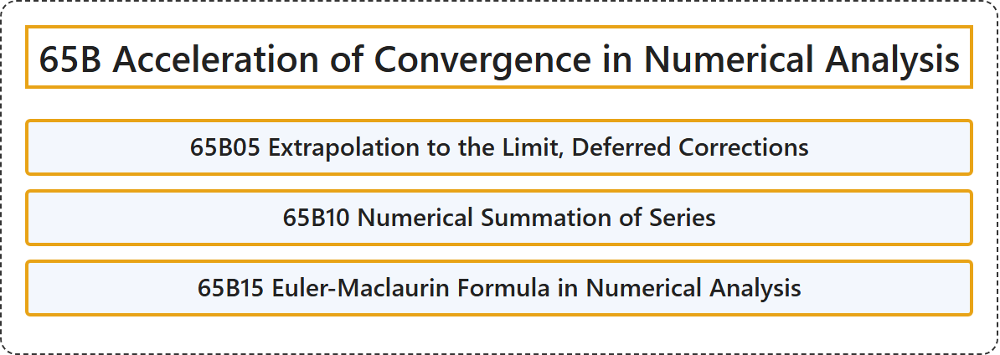

# 65B Acceleration of Convergence in Numerical Analysis

## Classification

## Glossary

| Term | Definition | 中文翻译 | Source |
|---|---|---|---|
| **65B Acceleration of Convergence in Numerical Analysis** 数值分析中的收敛加速 | (No definition) | （无定义） | [Associate Editors of Mathematical Reviews and zbMATH, 2020](https://msc2020.org/) |
| **65B05 Extrapolation to the Limit, Deferred Corrections** 外推到极限、延迟校正 | (No definition) | （无定义） | [Associate Editors of Mathematical Reviews and zbMATH, 2020](https://msc2020.org/) |
| **65B10 Numerical Summation of Series** 级数的数值求和 | (No definition) | （无定义） | [Associate Editors of Mathematical Reviews and zbMATH, 2020](https://msc2020.org/) |
| **65B15 Euler-Maclaurin Formula in Numerical Analysis** 数值分析中的欧拉-麦克劳林公式 | (No definition) | （无定义） | [Associate Editors of Mathematical Reviews and zbMATH, 2020](https://msc2020.org/) |

## References

Associate Editors of Mathematical Reviews and zbMATH. (2020). *MSC2020: Mathematics Subject Classification system*. Retrieved October 27, 2026, from <https://msc2020.org/>
