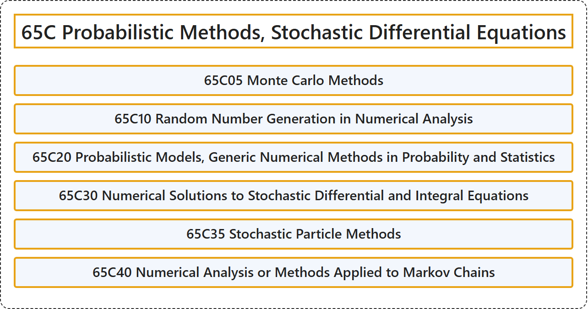

# 65C Probabilistic Methods, Stochastic Differential Equations

## Classification

## Glossary

| Term | Definition | 中文翻译 | Source |
|---|---|---|---|
| **65C Probabilistic Methods, Stochastic Differential Equations** 概率方法、随机微分方程 | (No definition) | （无定义） | [Associate Editors of Mathematical Reviews and zbMATH, 2020](https://msc2020.org/) |
| **65C05 Monte Carlo Methods** 蒙特卡罗方法 | (No definition) | （无定义） | [Associate Editors of Mathematical Reviews and zbMATH, 2020](https://msc2020.org/) |
| **65C10 Random Number Generation in Numerical Analysis** 数值分析中的随机数生成 | (No definition) | （无定义） | [Associate Editors of Mathematical Reviews and zbMATH, 2020](https://msc2020.org/) |
| **65C20 Probabilistic Models, Generic Numerical Methods in Probability and Statistics** 概率模型、概率与统计中的通用数值方法 | (No definition) | （无定义） | [Associate Editors of Mathematical Reviews and zbMATH, 2020](https://msc2020.org/) |
| **65C30 Numerical Solutions to Stochastic Differential and Integral Equations** 随机微分方程与随机积分方程的数值解 | (No definition) | （无定义） | [Associate Editors of Mathematical Reviews and zbMATH, 2020](https://msc2020.org/) |
| **65C35 Stochastic Particle Methods** 随机粒子方法 | (No definition) | （无定义） | [Associate Editors of Mathematical Reviews and zbMATH, 2020](https://msc2020.org/) |
| **65C40 Numerical Analysis or Methods Applied to Markov Chains** 应用于马尔可夫链的数值分析或数值方法 | (No definition) | （无定义） | [Associate Editors of Mathematical Reviews and zbMATH, 2020](https://msc2020.org/) |

## References

Associate Editors of Mathematical Reviews and zbMATH. (2020). *MSC2020: Mathematics Subject Classification system*. Retrieved October 27, 2026, from <https://msc2020.org/>
