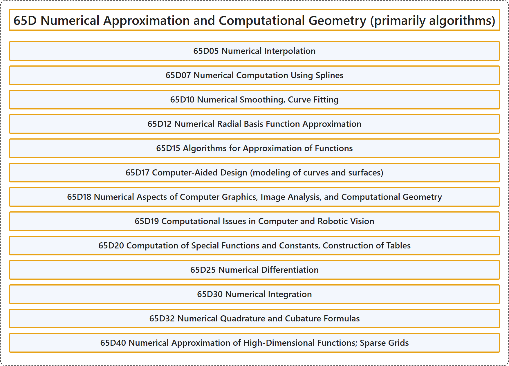

# 65D Numerical Approximation and Computational Geometry (primarily algorithms)

## Classification

## Glossary

| Term | Definition | 中文翻译 | Source |
|---|---|---|---|
| **65D Numerical Approximation and Computational Geometry (primarily algorithms)** 数值逼近与计算几何（主要为算法） | (No definition) | （无定义） | [Associate Editors of Mathematical Reviews and zbMATH, 2020](https://msc2020.org/) |
| **65D05 Numerical Interpolation** 数值插值 | (No definition) | （无定义） | [Associate Editors of Mathematical Reviews and zbMATH, 2020](https://msc2020.org/) |
| **65D07 Numerical Computation Using Splines** 使用样条的数值计算 | (No definition) | （无定义） | [Associate Editors of Mathematical Reviews and zbMATH, 2020](https://msc2020.org/) |
| **65D10 Numerical Smoothing, Curve Fitting** 数值光滑、曲线拟合 | (No definition) | （无定义） | [Associate Editors of Mathematical Reviews and zbMATH, 2020](https://msc2020.org/) |
| **65D12 Numerical Radial Basis Function Approximation** 数值径向基函数逼近 | (No definition) | （无定义） | [Associate Editors of Mathematical Reviews and zbMATH, 2020](https://msc2020.org/) |
| **65D15 Algorithms for Approximation of Functions** 函数逼近算法 | (No definition) | （无定义） | [Associate Editors of Mathematical Reviews and zbMATH, 2020](https://msc2020.org/) |
| **65D17 Computer-Aided Design (modeling of curves and surfaces)** 计算机辅助设计（曲线与曲面的建模） | (No definition) | （无定义） | [Associate Editors of Mathematical Reviews and zbMATH, 2020](https://msc2020.org/) |
| **65D18 Numerical Aspects of Computer Graphics, Image Analysis, and Computational Geometry** 计算机图形学、图像分析与计算几何的数值方面 | (No definition) | （无定义） | [Associate Editors of Mathematical Reviews and zbMATH, 2020](https://msc2020.org/) |
| **65D19 Computational Issues in Computer and Robotic Vision** 计算机视觉与机器人视觉中的计算问题 | (No definition) | （无定义） | [Associate Editors of Mathematical Reviews and zbMATH, 2020](https://msc2020.org/) |
| **65D20 Computation of Special Functions and Constants, Construction of Tables** 特殊函数与常数的计算、表的构造 | (No definition) | （无定义） | [Associate Editors of Mathematical Reviews and zbMATH, 2020](https://msc2020.org/) |
| **65D25 Numerical Differentiation** 数值微分 | (No definition) | （无定义） | [Associate Editors of Mathematical Reviews and zbMATH, 2020](https://msc2020.org/) |
| **65D30 Numerical Integration** 数值积分 | (No definition) | （无定义） | [Associate Editors of Mathematical Reviews and zbMATH, 2020](https://msc2020.org/) |
| **65D32 Numerical Quadrature and Cubature Formulas** 数值求积与求容公式 | (No definition) | （无定义） | [Associate Editors of Mathematical Reviews and zbMATH, 2020](https://msc2020.org/) |
| **65D40 Numerical Approximation of High-Dimensional Functions; Sparse Grids** 高维函数的数值逼近；稀疏网格 | (No definition) | （无定义） | [Associate Editors of Mathematical Reviews and zbMATH, 2020](https://msc2020.org/) |

## References

Associate Editors of Mathematical Reviews and zbMATH. (2020). *MSC2020: Mathematics Subject Classification system*. Retrieved October 27, 2026, from <https://msc2020.org/>
