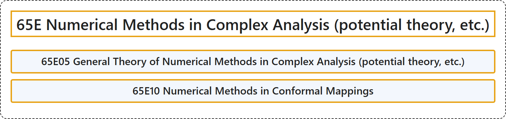

# 65E Numerical Methods in Complex Analysis (potential theory, etc.)

## Classification

## Glossary

| Term | Definition | 中文翻译 | Source |
|---|---|---|---|
| **65E Numerical Methods in Complex Analysis (potential theory, etc.)** 复分析中的数值方法（位势论等） | (No definition) | （无定义） | [Associate Editors of Mathematical Reviews and zbMATH, 2020](https://msc2020.org/) |
| **65E05 General Theory of Numerical Methods in Complex Analysis (potential theory, etc.)** 复分析中数值方法的一般理论（位势论等） | (No definition) | （无定义） | [Associate Editors of Mathematical Reviews and zbMATH, 2020](https://msc2020.org/) |
| **65E10 Numerical Methods in Conformal Mappings** 共形映射中的数值方法 | (No definition) | （无定义） | [Associate Editors of Mathematical Reviews and zbMATH, 2020](https://msc2020.org/) |

## References

Associate Editors of Mathematical Reviews and zbMATH. (2020). *MSC2020: Mathematics Subject Classification system*. Retrieved October 27, 2026, from <https://msc2020.org/>
