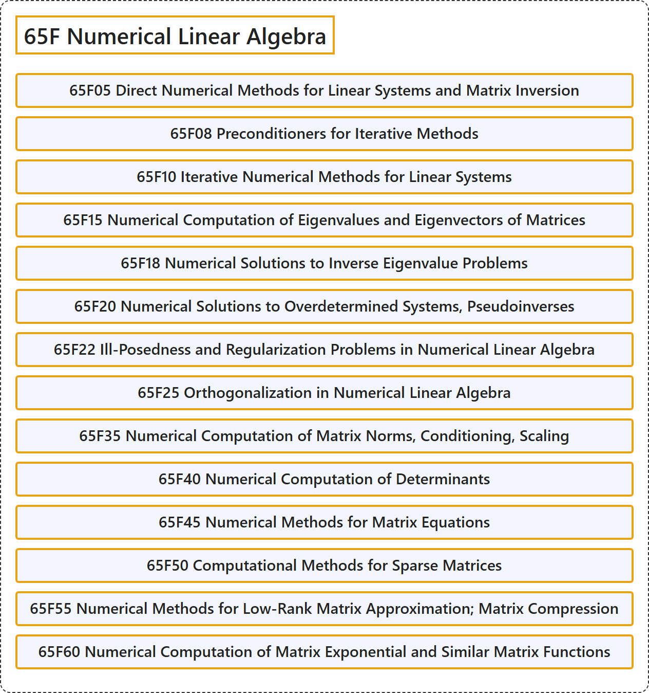

# 65F Numerical Linear Algebra

## Classification

## Glossary

| Term | Definition | 中文翻译 | Source |
|---|---|---|---|
| **65F Numerical Linear Algebra** 数值线性代数 | (No definition) | （无定义） | [Associate Editors of Mathematical Reviews and zbMATH, 2020](https://msc2020.org/) |
| **65F05 Direct Numerical Methods for Linear Systems and Matrix Inversion** 线性方程组与矩阵求逆的直接数值方法 | (No definition) | （无定义） | [Associate Editors of Mathematical Reviews and zbMATH, 2020](https://msc2020.org/) |
| **65F08 Preconditioners for Iterative Methods** 迭代方法的预条件子 | (No definition) | （无定义） | [Associate Editors of Mathematical Reviews and zbMATH, 2020](https://msc2020.org/) |
| **65F10 Iterative Numerical Methods for Linear Systems** 线性方程组的迭代数值方法 | (No definition) | （无定义） | [Associate Editors of Mathematical Reviews and zbMATH, 2020](https://msc2020.org/) |
| **65F15 Numerical Computation of Eigenvalues and Eigenvectors of Matrices** 矩阵特征值与特征向量的数值计算 | (No definition) | （无定义） | [Associate Editors of Mathematical Reviews and zbMATH, 2020](https://msc2020.org/) |
| **65F18 Numerical Solutions to Inverse Eigenvalue Problems** 逆特征值问题的数值解 | (No definition) | （无定义） | [Associate Editors of Mathematical Reviews and zbMATH, 2020](https://msc2020.org/) |
| **65F20 Numerical Solutions to Overdetermined Systems, Pseudoinverses** 超定方程组的数值解、伪逆 | (No definition) | （无定义） | [Associate Editors of Mathematical Reviews and zbMATH, 2020](https://msc2020.org/) |
| **65F22 Ill-Posedness and Regularization Problems in Numerical Linear Algebra** 数值线性代数中的不适定性与正则化问题 | (No definition) | （无定义） | [Associate Editors of Mathematical Reviews and zbMATH, 2020](https://msc2020.org/) |
| **65F25 Orthogonalization in Numerical Linear Algebra** 数值线性代数中的正交化 | (No definition) | （无定义） | [Associate Editors of Mathematical Reviews and zbMATH, 2020](https://msc2020.org/) |
| **65F35 Numerical Computation of Matrix Norms, Conditioning, Scaling** 矩阵范数、条件数、缩放的数值计算 | (No definition) | （无定义） | [Associate Editors of Mathematical Reviews and zbMATH, 2020](https://msc2020.org/) |
| **65F40 Numerical Computation of Determinants** 行列式的数值计算 | (No definition) | （无定义） | [Associate Editors of Mathematical Reviews and zbMATH, 2020](https://msc2020.org/) |
| **65F45 Numerical Methods for Matrix Equations** 矩阵方程的数值方法 | (No definition) | （无定义） | [Associate Editors of Mathematical Reviews and zbMATH, 2020](https://msc2020.org/) |
| **65F50 Computational Methods for Sparse Matrices** 稀疏矩阵的计算方法 | (No definition) | （无定义） | [Associate Editors of Mathematical Reviews and zbMATH, 2020](https://msc2020.org/) |
| **65F55 Numerical Methods for Low-Rank Matrix Approximation; Matrix Compression** 低秩矩阵逼近的数值方法；矩阵压缩 | (No definition) | （无定义） | [Associate Editors of Mathematical Reviews and zbMATH, 2020](https://msc2020.org/) |
| **65F60 Numerical Computation of Matrix Exponential and Similar Matrix Functions** 矩阵指数及类似矩阵函数的数值计算 | (No definition) | （无定义） | [Associate Editors of Mathematical Reviews and zbMATH, 2020](https://msc2020.org/) |

## References

Associate Editors of Mathematical Reviews and zbMATH. (2020). *MSC2020: Mathematics Subject Classification system*. Retrieved October 27, 2026, from <https://msc2020.org/>
