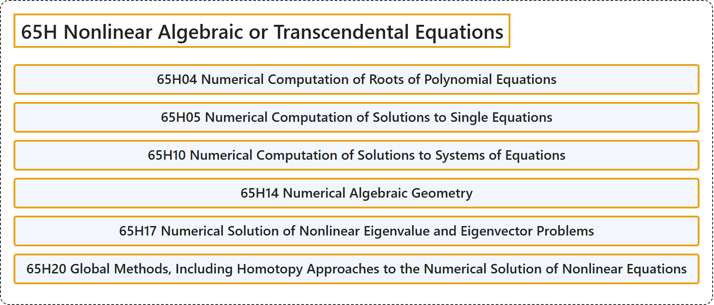

# 65H Nonlinear Algebraic or Transcendental Equations

## Classification

## Glossary

| Term | Definition | 中文翻译 | Source |
|---|---|---|---|
| **65H Nonlinear Algebraic or Transcendental Equations** 非线性代数方程或超越方程 | (No definition) | （无定义） | [Associate Editors of Mathematical Reviews and zbMATH, 2020](https://msc2020.org/) |
| **65H04 Numerical Computation of Roots of Polynomial Equations** 多项式方程根的数值计算 | (No definition) | （无定义） | [Associate Editors of Mathematical Reviews and zbMATH, 2020](https://msc2020.org/) |
| **65H05 Numerical Computation of Solutions to Single Equations** 单个方程解的数值计算 | (No definition) | （无定义） | [Associate Editors of Mathematical Reviews and zbMATH, 2020](https://msc2020.org/) |
| **65H10 Numerical Computation of Solutions to Systems of Equations** 方程组解的数值计算 | (No definition) | （无定义） | [Associate Editors of Mathematical Reviews and zbMATH, 2020](https://msc2020.org/) |
| **65H14 Numerical Algebraic Geometry** 数值代数几何 | (No definition) | （无定义） | [Associate Editors of Mathematical Reviews and zbMATH, 2020](https://msc2020.org/) |
| **65H17 Numerical Solution of Nonlinear Eigenvalue and Eigenvector Problems** 非线性特征值与特征向量问题的数值解 | (No definition) | （无定义） | [Associate Editors of Mathematical Reviews and zbMATH, 2020](https://msc2020.org/) |
| **65H20 Global Methods, Including Homotopy Approaches to the Numerical Solution of Nonlinear Equations** 非线性方程数值解的整体方法，包括同伦方法 | (No definition) | （无定义） | [Associate Editors of Mathematical Reviews and zbMATH, 2020](https://msc2020.org/) |

## References

Associate Editors of Mathematical Reviews and zbMATH. (2020). *MSC2020: Mathematics Subject Classification system*. Retrieved October 27, 2026, from <https://msc2020.org/>
