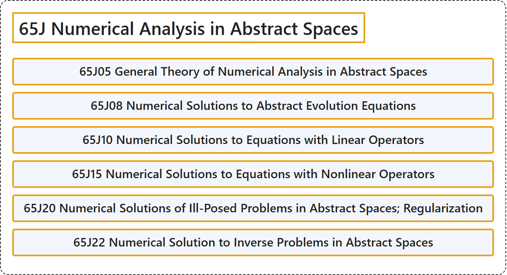

# 65J Numerical Analysis in Abstract Spaces

## Classification

## Glossary

| Term | Definition | 中文翻译 | Source |
|---|---|---|---|
| **65J Numerical Analysis in Abstract Spaces** 抽象空间中的数值分析 | (No definition) | （无定义） | [Associate Editors of Mathematical Reviews and zbMATH, 2020](https://msc2020.org/) |
| **65J05 General Theory of Numerical Analysis in Abstract Spaces** 抽象空间中数值分析的一般理论 | (No definition) | （无定义） | [Associate Editors of Mathematical Reviews and zbMATH, 2020](https://msc2020.org/) |
| **65J08 Numerical Solutions to Abstract Evolution Equations** 抽象发展方程的数值解 | (No definition) | （无定义） | [Associate Editors of Mathematical Reviews and zbMATH, 2020](https://msc2020.org/) |
| **65J10 Numerical Solutions to Equations with Linear Operators** 含线性算子的方程的数值解 | (No definition) | （无定义） | [Associate Editors of Mathematical Reviews and zbMATH, 2020](https://msc2020.org/) |
| **65J15 Numerical Solutions to Equations with Nonlinear Operators** 含非线性算子的方程的数值解 | (No definition) | （无定义） | [Associate Editors of Mathematical Reviews and zbMATH, 2020](https://msc2020.org/) |
| **65J20 Numerical Solutions of Ill-Posed Problems in Abstract Spaces; Regularization** 抽象空间中不适定问题的数值解；正则化 | (No definition) | （无定义） | [Associate Editors of Mathematical Reviews and zbMATH, 2020](https://msc2020.org/) |
| **65J22 Numerical Solution to Inverse Problems in Abstract Spaces** 抽象空间中反问题的数值解 | (No definition) | （无定义） | [Associate Editors of Mathematical Reviews and zbMATH, 2020](https://msc2020.org/) |

## References

Associate Editors of Mathematical Reviews and zbMATH. (2020). *MSC2020: Mathematics Subject Classification system*. Retrieved October 27, 2026, from <https://msc2020.org/>
