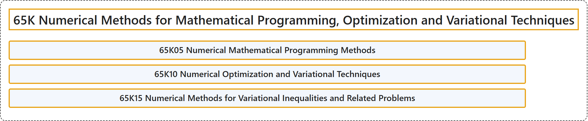

# 65K Numerical Methods for Mathematical Programming, Optimization and Variational Techniques

## Classification

## Glossary

| Term | Definition | 中文翻译 | Source |
|---|---|---|---|
| **65K Numerical Methods for Mathematical Programming, Optimization and Variational Techniques** 数学规划、最优化与变分技术的数值方法 | (No definition) | （无定义） | [Associate Editors of Mathematical Reviews and zbMATH, 2020](https://msc2020.org/) |
| **65K05 Numerical Mathematical Programming Methods** 数值数学规划方法 | (No definition) | （无定义） | [Associate Editors of Mathematical Reviews and zbMATH, 2020](https://msc2020.org/) |
| **65K10 Numerical Optimization and Variational Techniques** 数值最优化与变分技术 | (No definition) | （无定义） | [Associate Editors of Mathematical Reviews and zbMATH, 2020](https://msc2020.org/) |
| **65K15 Numerical Methods for Variational Inequalities and Related Problems** 变分不等式及相关问题的数值方法 | (No definition) | （无定义） | [Associate Editors of Mathematical Reviews and zbMATH, 2020](https://msc2020.org/) |

## References

Associate Editors of Mathematical Reviews and zbMATH. (2020). *MSC2020: Mathematics Subject Classification system*. Retrieved October 27, 2026, from <https://msc2020.org/>
