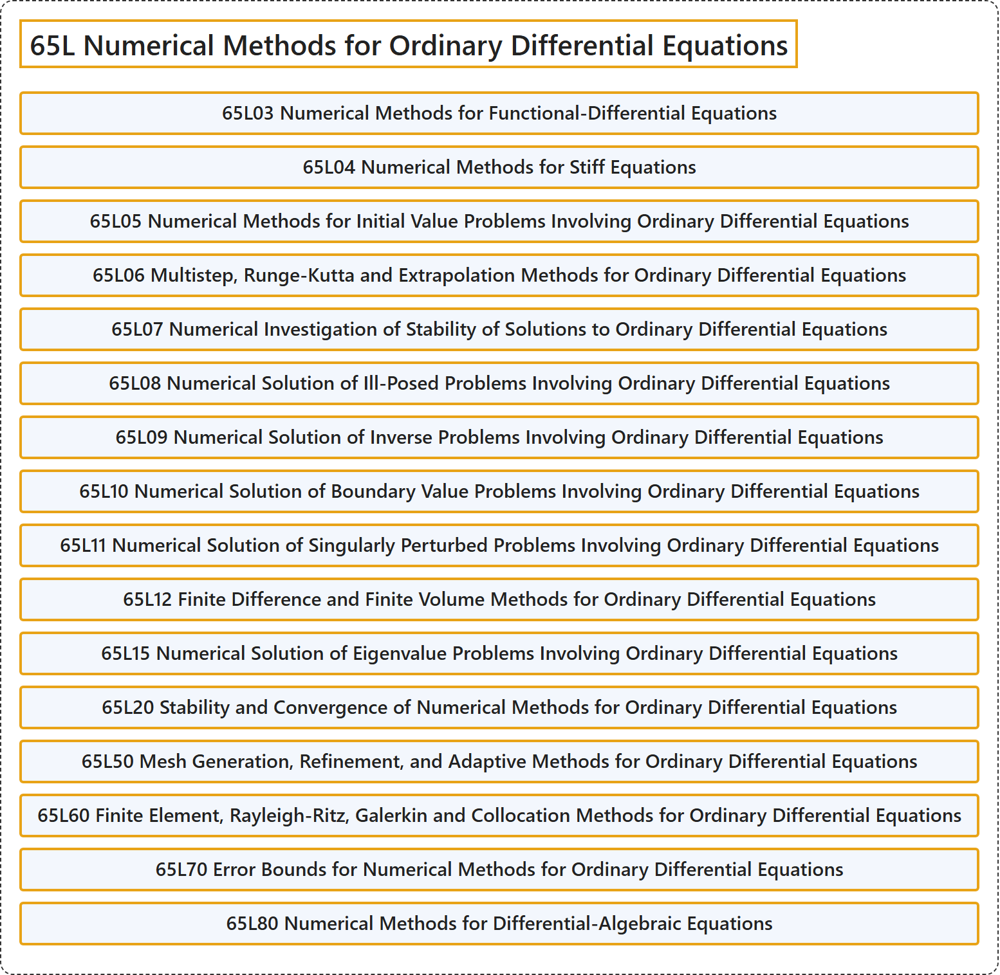

# 65L Numerical Methods for Ordinary Differential Equations

## Classification

## Glossary

| Term | Definition | 中文翻译 | Source |
|---|---|---|---|
| **65L Numerical Methods for Ordinary Differential Equations** 常微分方程数值方法 | (No definition) | （无定义） | [Associate Editors of Mathematical Reviews and zbMATH, 2020](https://msc2020.org/) |
| **65L03 Numerical Methods for Functional-Differential Equations** 泛函微分方程的数值方法 | (No definition) | （无定义） | [Associate Editors of Mathematical Reviews and zbMATH, 2020](https://msc2020.org/) |
| **65L04 Numerical Methods for Stiff Equations** 刚性方程的数值方法 | (No definition) | （无定义） | [Associate Editors of Mathematical Reviews and zbMATH, 2020](https://msc2020.org/) |
| **65L05 Numerical Methods for Initial Value Problems Involving Ordinary Differential Equations** 常微分方程初值问题的数值方法 | (No definition) | （无定义） | [Associate Editors of Mathematical Reviews and zbMATH, 2020](https://msc2020.org/) |
| **65L06 Multistep, Runge-Kutta and Extrapolation Methods for Ordinary Differential Equations** 常微分方程的多步法、龙格-库塔法与外推法 | (No definition) | （无定义） | [Associate Editors of Mathematical Reviews and zbMATH, 2020](https://msc2020.org/) |
| **65L07 Numerical Investigation of Stability of Solutions to Ordinary Differential Equations** 常微分方程解的稳定性的数值研究 | (No definition) | （无定义） | [Associate Editors of Mathematical Reviews and zbMATH, 2020](https://msc2020.org/) |
| **65L08 Numerical Solution of Ill-Posed Problems Involving Ordinary Differential Equations** 常微分方程不适定问题的数值解 | (No definition) | （无定义） | [Associate Editors of Mathematical Reviews and zbMATH, 2020](https://msc2020.org/) |
| **65L09 Numerical Solution of Inverse Problems Involving Ordinary Differential Equations** 常微分方程反问题的数值解 | (No definition) | （无定义） | [Associate Editors of Mathematical Reviews and zbMATH, 2020](https://msc2020.org/) |
| **65L10 Numerical Solution of Boundary Value Problems Involving Ordinary Differential Equations** 常微分方程边值问题的数值解 | (No definition) | （无定义） | [Associate Editors of Mathematical Reviews and zbMATH, 2020](https://msc2020.org/) |
| **65L11 Numerical Solution of Singularly Perturbed Problems Involving Ordinary Differential Equations** 常微分方程奇异摄动问题的数值解 | (No definition) | （无定义） | [Associate Editors of Mathematical Reviews and zbMATH, 2020](https://msc2020.org/) |
| **65L12 Finite Difference and Finite Volume Methods for Ordinary Differential Equations** 常微分方程的有限差分法与有限体积法 | (No definition) | （无定义） | [Associate Editors of Mathematical Reviews and zbMATH, 2020](https://msc2020.org/) |
| **65L15 Numerical Solution of Eigenvalue Problems Involving Ordinary Differential Equations** 常微分方程特征值问题的数值解 | (No definition) | （无定义） | [Associate Editors of Mathematical Reviews and zbMATH, 2020](https://msc2020.org/) |
| **65L20 Stability and Convergence of Numerical Methods for Ordinary Differential Equations** 常微分方程数值方法的稳定性与收敛性 | (No definition) | （无定义） | [Associate Editors of Mathematical Reviews and zbMATH, 2020](https://msc2020.org/) |
| **65L50 Mesh Generation, Refinement, and Adaptive Methods for Ordinary Differential Equations** 常微分方程的网格生成、加密与自适应方法 | (No definition) | （无定义） | [Associate Editors of Mathematical Reviews and zbMATH, 2020](https://msc2020.org/) |
| **65L60 Finite Element, Rayleigh-Ritz, Galerkin and Collocation Methods for Ordinary Differential Equations** 常微分方程的有限元法、瑞利-里茨法、伽辽金法与配置法 | (No definition) | （无定义） | [Associate Editors of Mathematical Reviews and zbMATH, 2020](https://msc2020.org/) |
| **65L70 Error Bounds for Numerical Methods for Ordinary Differential Equations** 常微分方程数值方法的误差界 | (No definition) | （无定义） | [Associate Editors of Mathematical Reviews and zbMATH, 2020](https://msc2020.org/) |
| **65L80 Numerical Methods for Differential-Algebraic Equations** 微分代数方程的数值方法 | (No definition) | （无定义） | [Associate Editors of Mathematical Reviews and zbMATH, 2020](https://msc2020.org/) |

## References

Associate Editors of Mathematical Reviews and zbMATH. (2020). *MSC2020: Mathematics Subject Classification system*. Retrieved October 27, 2026, from <https://msc2020.org/>
