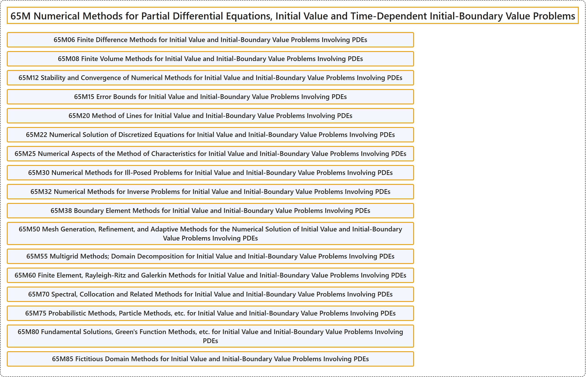

# 65M Numerical Methods for Partial Differential Equations, Initial Value and Time-Dependent Initial-Boundary Value Problems

## Classification

## Glossary

| Term | Definition | 中文翻译 | Source |
|---|---|---|---|
| **65M Numerical Methods for Partial Differential Equations, Initial Value and Time-Dependent Initial-Boundary Value Problems** 偏微分方程数值方法、初值问题与依赖时间的初边值问题 | (No definition) | （无定义） | [Associate Editors of Mathematical Reviews and zbMATH, 2020](https://msc2020.org/) |
| **65M06 Finite Difference Methods for Initial Value and Initial-Boundary Value Problems Involving PDEs** 涉及 PDE 的初值问题与初边值问题的有限差分法 | (No definition) | （无定义） | [Associate Editors of Mathematical Reviews and zbMATH, 2020](https://msc2020.org/) |
| **65M08 Finite Volume Methods for Initial Value and Initial-Boundary Value Problems Involving PDEs** 涉及 PDE 的初值问题与初边值问题的有限体积法 | (No definition) | （无定义） | [Associate Editors of Mathematical Reviews and zbMATH, 2020](https://msc2020.org/) |
| **65M12 Stability and Convergence of Numerical Methods for Initial Value and Initial-Boundary Value Problems Involving PDEs** 涉及 PDE 的初值问题与初边值问题数值方法的稳定性与收敛性 | (No definition) | （无定义） | [Associate Editors of Mathematical Reviews and zbMATH, 2020](https://msc2020.org/) |
| **65M15 Error Bounds for Initial Value and Initial-Boundary Value Problems Involving PDEs** 涉及 PDE 的初值问题与初边值问题的误差界 | (No definition) | （无定义） | [Associate Editors of Mathematical Reviews and zbMATH, 2020](https://msc2020.org/) |
| **65M20 Method of Lines for Initial Value and Initial-Boundary Value Problems Involving PDEs** 涉及 PDE 的初值问题与初边值问题的直线法 | (No definition) | （无定义） | [Associate Editors of Mathematical Reviews and zbMATH, 2020](https://msc2020.org/) |
| **65M22 Numerical Solution of Discretized Equations for Initial Value and Initial-Boundary Value Problems Involving PDEs** 涉及 PDE 的初值问题与初边值问题离散方程的数值解 | (No definition) | （无定义） | [Associate Editors of Mathematical Reviews and zbMATH, 2020](https://msc2020.org/) |
| **65M25 Numerical Aspects of the Method of Characteristics for Initial Value and Initial-Boundary Value Problems Involving PDEs** 涉及 PDE 的初值问题与初边值问题的特征线法的数值方面 | (No definition) | （无定义） | [Associate Editors of Mathematical Reviews and zbMATH, 2020](https://msc2020.org/) |
| **65M30 Numerical Methods for Ill-Posed Problems for Initial Value and Initial-Boundary Value Problems Involving PDEs** 涉及 PDE 的初值问题与初边值问题不适定问题的数值方法 | (No definition) | （无定义） | [Associate Editors of Mathematical Reviews and zbMATH, 2020](https://msc2020.org/) |
| **65M32 Numerical Methods for Inverse Problems for Initial Value and Initial-Boundary Value Problems Involving PDEs** 涉及 PDE 的初值问题与初边值问题反问题的数值方法 | (No definition) | （无定义） | [Associate Editors of Mathematical Reviews and zbMATH, 2020](https://msc2020.org/) |
| **65M38 Boundary Element Methods for Initial Value and Initial-Boundary Value Problems Involving PDEs** 涉及 PDE 的初值问题与初边值问题的边界元法 | (No definition) | （无定义） | [Associate Editors of Mathematical Reviews and zbMATH, 2020](https://msc2020.org/) |
| **65M50 Mesh Generation, Refinement, and Adaptive Methods for the Numerical Solution of Initial Value and Initial-Boundary Value Problems Involving PDEs** 涉及 PDE 的初值问题与初边值问题数值解的网格生成、加密与自适应方法 | (No definition) | （无定义） | [Associate Editors of Mathematical Reviews and zbMATH, 2020](https://msc2020.org/) |
| **65M55 Multigrid Methods; Domain Decomposition for Initial Value and Initial-Boundary Value Problems Involving PDEs** 涉及 PDE 的初值问题与初边值问题的多重网格法；区域分解 | (No definition) | （无定义） | [Associate Editors of Mathematical Reviews and zbMATH, 2020](https://msc2020.org/) |
| **65M60 Finite Element, Rayleigh-Ritz and Galerkin Methods for Initial Value and Initial-Boundary Value Problems Involving PDEs** 涉及 PDE 的初值问题与初边值问题的有限元法、瑞利-里茨法与伽辽金法 | (No definition) | （无定义） | [Associate Editors of Mathematical Reviews and zbMATH, 2020](https://msc2020.org/) |
| **65M70 Spectral, Collocation and Related Methods for Initial Value and Initial-Boundary Value Problems Involving PDEs** 涉及 PDE 的初值问题与初边值问题的谱方法、配置法及相关方法 | (No definition) | （无定义） | [Associate Editors of Mathematical Reviews and zbMATH, 2020](https://msc2020.org/) |
| **65M75 Probabilistic Methods, Particle Methods, etc. for Initial Value and Initial-Boundary Value Problems Involving PDEs** 涉及 PDE 的初值问题与初边值问题的概率方法、粒子方法等 | (No definition) | （无定义） | [Associate Editors of Mathematical Reviews and zbMATH, 2020](https://msc2020.org/) |
| **65M80 Fundamental Solutions, Green's Function Methods, etc. for Initial Value and Initial-Boundary Value Problems Involving PDEs** 涉及 PDE 的初值问题与初边值问题的基本解、格林函数方法等 | (No definition) | （无定义） | [Associate Editors of Mathematical Reviews and zbMATH, 2020](https://msc2020.org/) |
| **65M85 Fictitious Domain Methods for Initial Value and Initial-Boundary Value Problems Involving PDEs** 涉及 PDE 的初值问题与初边值问题的虚拟区域法 | (No definition) | （无定义） | [Associate Editors of Mathematical Reviews and zbMATH, 2020](https://msc2020.org/) |

## References

Associate Editors of Mathematical Reviews and zbMATH. (2020). *MSC2020: Mathematics Subject Classification system*. Retrieved October 27, 2026, from <https://msc2020.org/>
