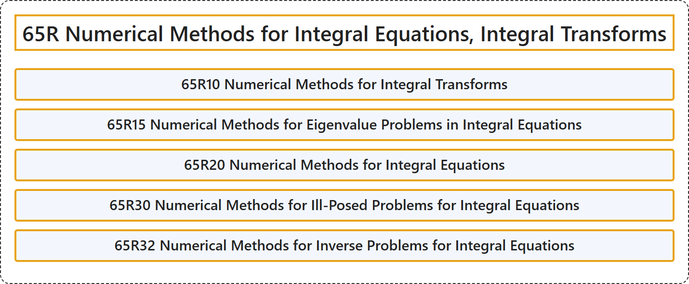

# 65R Numerical Methods for Integral Equations, Integral Transforms

## Classification

## Glossary

| Term | Definition | 中文翻译 | Source |
|---|---|---|---|
| **65R Numerical Methods for Integral Equations, Integral Transforms** 积分方程、积分变换的数值方法 | (No definition) | （无定义） | [Associate Editors of Mathematical Reviews and zbMATH, 2020](https://msc2020.org/) |
| **65R10 Numerical Methods for Integral Transforms** 积分变换的数值方法 | (No definition) | （无定义） | [Associate Editors of Mathematical Reviews and zbMATH, 2020](https://msc2020.org/) |
| **65R15 Numerical Methods for Eigenvalue Problems in Integral Equations** 积分方程中特征值问题的数值方法 | (No definition) | （无定义） | [Associate Editors of Mathematical Reviews and zbMATH, 2020](https://msc2020.org/) |
| **65R20 Numerical Methods for Integral Equations** 积分方程的数值方法 | (No definition) | （无定义） | [Associate Editors of Mathematical Reviews and zbMATH, 2020](https://msc2020.org/) |
| **65R30 Numerical Methods for Ill-Posed Problems for Integral Equations** 积分方程不适定问题的数值方法 | (No definition) | （无定义） | [Associate Editors of Mathematical Reviews and zbMATH, 2020](https://msc2020.org/) |
| **65R32 Numerical Methods for Inverse Problems for Integral Equations** 积分方程反问题的数值方法 | (No definition) | （无定义） | [Associate Editors of Mathematical Reviews and zbMATH, 2020](https://msc2020.org/) |

## References

Associate Editors of Mathematical Reviews and zbMATH. (2020). *MSC2020: Mathematics Subject Classification system*. Retrieved October 27, 2026, from <https://msc2020.org/>
