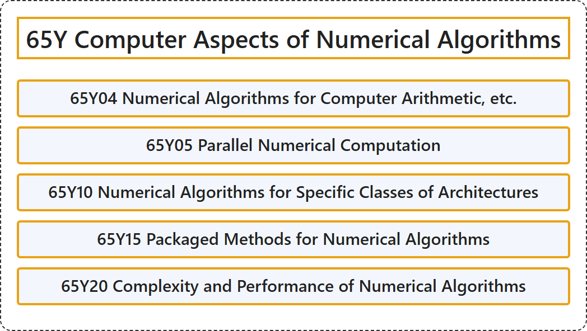

# 65Y Computer Aspects of Numerical Algorithms

## Classification

## Glossary

| Term | Definition | 中文翻译 | Source |
|---|---|---|---|
| **65Y Computer Aspects of Numerical Algorithms** 数值算法的计算机方面 | (No definition) | （无定义） | [Associate Editors of Mathematical Reviews and zbMATH, 2020](https://msc2020.org/) |
| **65Y04 Numerical Algorithms for Computer Arithmetic, etc.** 计算机算术等的数值算法 | (No definition) | （无定义） | [Associate Editors of Mathematical Reviews and zbMATH, 2020](https://msc2020.org/) |
| **65Y05 Parallel Numerical Computation** 并行数值计算 | (No definition) | （无定义） | [Associate Editors of Mathematical Reviews and zbMATH, 2020](https://msc2020.org/) |
| **65Y10 Numerical Algorithms for Specific Classes of Architectures** 针对特定体系结构的数值算法 | (No definition) | （无定义） | [Associate Editors of Mathematical Reviews and zbMATH, 2020](https://msc2020.org/) |
| **65Y15 Packaged Methods for Numerical Algorithms** 数值算法的软件包方法 | (No definition) | （无定义） | [Associate Editors of Mathematical Reviews and zbMATH, 2020](https://msc2020.org/) |
| **65Y20 Complexity and Performance of Numerical Algorithms** 数值算法的复杂度与性能 | (No definition) | （无定义） | [Associate Editors of Mathematical Reviews and zbMATH, 2020](https://msc2020.org/) |

## References

Associate Editors of Mathematical Reviews and zbMATH. (2020). *MSC2020: Mathematics Subject Classification system*. Retrieved October 27, 2026, from <https://msc2020.org/>
