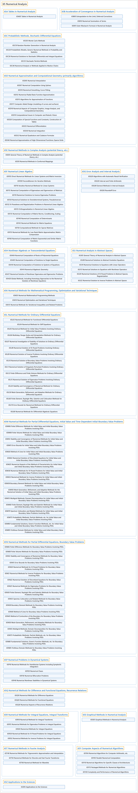

# 65 Numerical Analysis

## Classification

## Glossary

| Term | Definition | 中文翻译 | Source |
|---|---|---|---|
| **65 Numerical Analysis** 数值分析 | "Numerical analysis is the study of **algorithms for obtaining numerical approximations to mathematical problems**." | 数值分析研究**求数学问题数值近似解的算法**。 | [Weisstein, n.d., "Numerical analysis" entry, para. 1](https://mathworld.wolfram.com/NumericalAnalysis.html#:~:text=Numerical%20analysis%20is%20the%20study%20of%20algorithms) |
| **[65A Tables in Numerical Analysis](65a-tables-in-numerical-analysis.md)** 数值分析中的表 | (No definition) | （无定义） | [Associate Editors of Mathematical Reviews and zbMATH, 2020](https://msc2020.org/) |
| **[65B Acceleration of Convergence in Numerical Analysis](65b-acceleration-of-convergence-in-numerical-analysis.md)** 数值分析中的收敛加速 | (No definition) | （无定义） | [Associate Editors of Mathematical Reviews and zbMATH, 2020](https://msc2020.org/) |
| **[65C Probabilistic Methods, Stochastic Differential Equations](65c-probabilistic-methods-stochastic-differential-equations.md)** 概率方法、随机微分方程 | (No definition) | （无定义） | [Associate Editors of Mathematical Reviews and zbMATH, 2020](https://msc2020.org/) |
| **[65D Numerical Approximation and Computational Geometry (primarily algorithms)](65d-numerical-approximation-and-computational-geometry-primarily.md)** 数值逼近与计算几何（主要为算法） | (No definition) | （无定义） | [Associate Editors of Mathematical Reviews and zbMATH, 2020](https://msc2020.org/) |
| **[65E Numerical Methods in Complex Analysis (potential theory, etc.)](65e-numerical-methods-in-complex-analysis-potential-theory-etc.md)** 复分析中的数值方法（位势论等） | (No definition) | （无定义） | [Associate Editors of Mathematical Reviews and zbMATH, 2020](https://msc2020.org/) |
| **[65F Numerical Linear Algebra](65f-numerical-linear-algebra.md)** 数值线性代数 | (No definition) | （无定义） | [Associate Editors of Mathematical Reviews and zbMATH, 2020](https://msc2020.org/) |
| **[65G Error Analysis and Interval Analysis](65g-error-analysis-and-interval-analysis.md)** 误差分析与区间分析 | (No definition) | （无定义） | [Associate Editors of Mathematical Reviews and zbMATH, 2020](https://msc2020.org/) |
| **[65H Nonlinear Algebraic or Transcendental Equations](65h-nonlinear-algebraic-or-transcendental-equations.md)** 非线性代数方程或超越方程 | (No definition) | （无定义） | [Associate Editors of Mathematical Reviews and zbMATH, 2020](https://msc2020.org/) |
| **[65J Numerical Analysis in Abstract Spaces](65j-numerical-analysis-in-abstract-spaces.md)** 抽象空间中的数值分析 | (No definition) | （无定义） | [Associate Editors of Mathematical Reviews and zbMATH, 2020](https://msc2020.org/) |
| **[65K Numerical Methods for Mathematical Programming, Optimization and Variational Techniques](65k-numerical-methods-for-mathematical-programming-optimization.md)** 数学规划、最优化与变分技术的数值方法 | (No definition) | （无定义） | [Associate Editors of Mathematical Reviews and zbMATH, 2020](https://msc2020.org/) |
| **[65L Numerical Methods for Ordinary Differential Equations](65l-numerical-methods-for-ordinary-differential-equations.md)** 常微分方程数值方法 | (No definition) | （无定义） | [Associate Editors of Mathematical Reviews and zbMATH, 2020](https://msc2020.org/) |
| **[65M Numerical Methods for Partial Differential Equations, Initial Value and Time-Dependent Initial-Boundary Value Problems](65m-numerical-methods-for-partial-differential-equations-initial.md)** 偏微分方程数值方法、初值问题与依赖时间的初边值问题 | (No definition) | （无定义） | [Associate Editors of Mathematical Reviews and zbMATH, 2020](https://msc2020.org/) |
| **[65N Numerical Methods for Partial Differential Equations, Boundary Value Problems](65n-numerical-methods-for-partial-differential-equations-boundar.md)** 偏微分方程数值方法、边值问题 | (No definition) | （无定义） | [Associate Editors of Mathematical Reviews and zbMATH, 2020](https://msc2020.org/) |
| **[65P Numerical Problems in Dynamical Systems](65p-numerical-problems-in-dynamical-systems.md)** 动力系统中的数值问题 | (No definition) | （无定义） | [Associate Editors of Mathematical Reviews and zbMATH, 2020](https://msc2020.org/) |
| **[65Q Numerical Methods for Difference and Functional Equations, Recurrence Relations](65q-numerical-methods-for-difference-and-functional-equations-re.md)** 差分方程与函数方程、递推关系的数值方法 | (No definition) | （无定义） | [Associate Editors of Mathematical Reviews and zbMATH, 2020](https://msc2020.org/) |
| **[65R Numerical Methods for Integral Equations, Integral Transforms](65r-numerical-methods-for-integral-equations-integral-transforms.md)** 积分方程、积分变换的数值方法 | (No definition) | （无定义） | [Associate Editors of Mathematical Reviews and zbMATH, 2020](https://msc2020.org/) |
| **[65S Graphical Methods in Numerical Analysis](65s-graphical-methods-in-numerical-analysis.md)** 数值分析中的图示方法 | (No definition) | （无定义） | [Associate Editors of Mathematical Reviews and zbMATH, 2020](https://msc2020.org/) |
| **[65T Numerical Methods in Fourier Analysis](65t-numerical-methods-in-fourier-analysis.md)** 傅里叶分析中的数值方法 | (No definition) | （无定义） | [Associate Editors of Mathematical Reviews and zbMATH, 2020](https://msc2020.org/) |
| **[65Y Computer Aspects of Numerical Algorithms](65y-computer-aspects-of-numerical-algorithms.md)** 数值算法的计算机方面 | (No definition) | （无定义） | [Associate Editors of Mathematical Reviews and zbMATH, 2020](https://msc2020.org/) |
| **[65Z Applications to the Sciences](65z-applications-to-the-sciences.md)** 在科学中的应用 | (No definition) | （无定义） | [Associate Editors of Mathematical Reviews and zbMATH, 2020](https://msc2020.org/) |

## References

Associate Editors of Mathematical Reviews and zbMATH. (2020). *MSC2020: Mathematics Subject Classification system*. Retrieved October 27, 2026, from <https://msc2020.org/>

Weisstein, E. W. (n.d.). *Numerical analysis*. MathWorld: A Wolfram Resource. Retrieved October 27, 2026, from <https://mathworld.wolfram.com/NumericalAnalysis.html>
