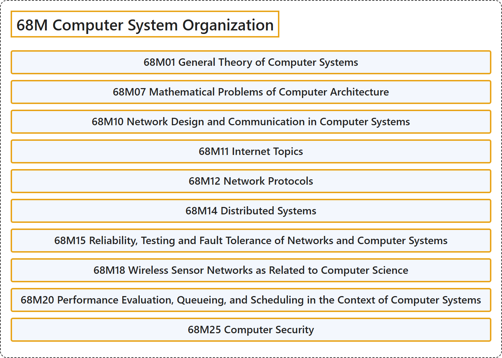

# 68M Computer System Organization

## Classification

## Glossary

| Term | Definition | 中文翻译 | Source |
|---|---|---|---|
| **68M Computer System Organization** 计算机系统组织 | (No definition) | （无定义） | [Associate Editors of Mathematical Reviews and zbMATH, 2020](https://msc2020.org/) |
| **68M01 General Theory of Computer Systems** 计算机系统的一般理论 | (No definition) | （无定义） | [Associate Editors of Mathematical Reviews and zbMATH, 2020](https://msc2020.org/) |
| **68M07 Mathematical Problems of Computer Architecture** 计算机体系结构的数学问题 | (No definition) | （无定义） | [Associate Editors of Mathematical Reviews and zbMATH, 2020](https://msc2020.org/) |
| **68M10 Network Design and Communication in Computer Systems** 计算机系统中的网络设计与通信 | (No definition) | （无定义） | [Associate Editors of Mathematical Reviews and zbMATH, 2020](https://msc2020.org/) |
| **68M11 Internet Topics** 互联网专题 | (No definition) | （无定义） | [Associate Editors of Mathematical Reviews and zbMATH, 2020](https://msc2020.org/) |
| **68M12 Network Protocols** 网络协议 | (No definition) | （无定义） | [Associate Editors of Mathematical Reviews and zbMATH, 2020](https://msc2020.org/) |
| **68M14 Distributed Systems** 分布式系统 | (No definition) | （无定义） | [Associate Editors of Mathematical Reviews and zbMATH, 2020](https://msc2020.org/) |
| **68M15 Reliability, Testing and Fault Tolerance of Networks and Computer Systems** 网络与计算机系统的可靠性、测试与容错 | (No definition) | （无定义） | [Associate Editors of Mathematical Reviews and zbMATH, 2020](https://msc2020.org/) |
| **68M18 Wireless Sensor Networks as Related to Computer Science** 与计算机科学相关的无线传感器网络 | (No definition) | （无定义） | [Associate Editors of Mathematical Reviews and zbMATH, 2020](https://msc2020.org/) |
| **68M20 Performance Evaluation, Queueing, and Scheduling in the Context of Computer Systems** 计算机系统中的性能评价、排队与调度 | (No definition) | （无定义） | [Associate Editors of Mathematical Reviews and zbMATH, 2020](https://msc2020.org/) |
| **68M25 Computer Security** 计算机安全 | (No definition) | （无定义） | [Associate Editors of Mathematical Reviews and zbMATH, 2020](https://msc2020.org/) |

## References

Associate Editors of Mathematical Reviews and zbMATH. (2020). *MSC2020: Mathematics Subject Classification system*. Retrieved October 27, 2026, from <https://msc2020.org/>
