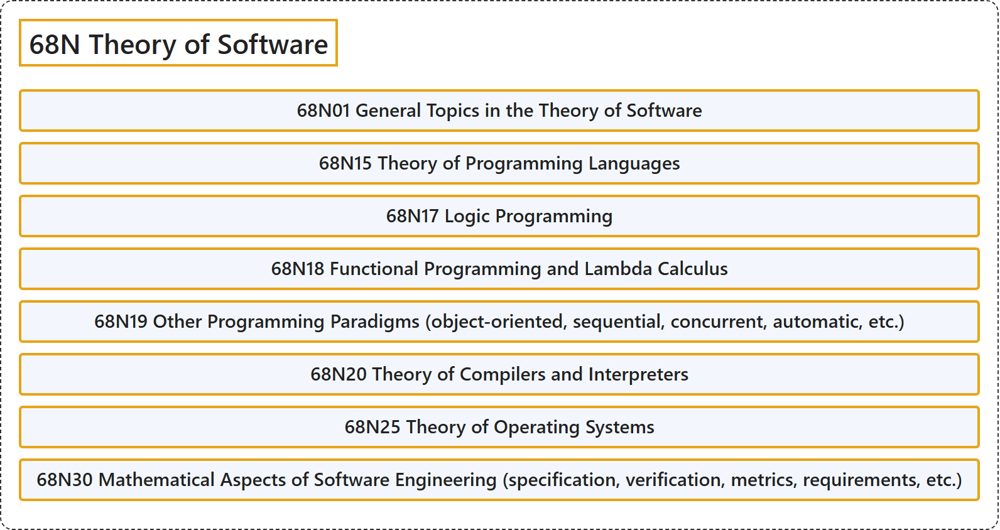

# 68N Theory of Software

## Classification

## Glossary

| Term | Definition | 中文翻译 | Source |
|---|---|---|---|
| **68N Theory of Software** 软件理论 | (No definition) | （无定义） | [Associate Editors of Mathematical Reviews and zbMATH, 2020](https://msc2020.org/) |
| **68N01 General Topics in the Theory of Software** 软件理论的一般专题 | (No definition) | （无定义） | [Associate Editors of Mathematical Reviews and zbMATH, 2020](https://msc2020.org/) |
| **68N15 Theory of Programming Languages** 程序设计语言理论 | (No definition) | （无定义） | [Associate Editors of Mathematical Reviews and zbMATH, 2020](https://msc2020.org/) |
| **68N17 Logic Programming** 逻辑程序设计 | (No definition) | （无定义） | [Associate Editors of Mathematical Reviews and zbMATH, 2020](https://msc2020.org/) |
| **68N18 Functional Programming and Lambda Calculus** 函数式程序设计与 lambda 演算 | (No definition) | （无定义） | [Associate Editors of Mathematical Reviews and zbMATH, 2020](https://msc2020.org/) |
| **68N19 Other Programming Paradigms (object-oriented, sequential, concurrent, automatic, etc.)** 其他程序设计范式（面向对象、顺序、并发、自动等） | (No definition) | （无定义） | [Associate Editors of Mathematical Reviews and zbMATH, 2020](https://msc2020.org/) |
| **68N20 Theory of Compilers and Interpreters** 编译器与解释器理论 | (No definition) | （无定义） | [Associate Editors of Mathematical Reviews and zbMATH, 2020](https://msc2020.org/) |
| **68N25 Theory of Operating Systems** 操作系统理论 | (No definition) | （无定义） | [Associate Editors of Mathematical Reviews and zbMATH, 2020](https://msc2020.org/) |
| **68N30 Mathematical Aspects of Software Engineering (specification, verification, metrics, requirements, etc.)** 软件工程的数学方面（规约、验证、度量、需求等） | (No definition) | （无定义） | [Associate Editors of Mathematical Reviews and zbMATH, 2020](https://msc2020.org/) |

## References

Associate Editors of Mathematical Reviews and zbMATH. (2020). *MSC2020: Mathematics Subject Classification system*. Retrieved October 27, 2026, from <https://msc2020.org/>
