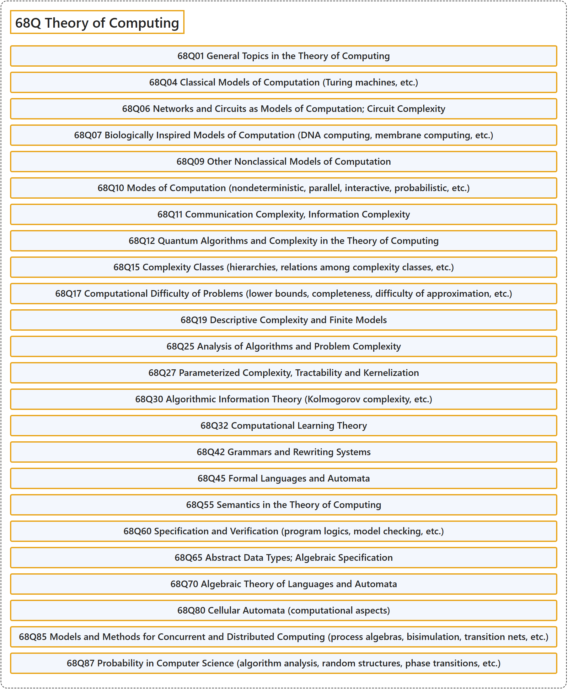

# 68Q Theory of Computing

## Classification

## Glossary

| Term | Definition | 中文翻译 | Source |
|---|---|---|---|
| **68Q Theory of Computing** 计算理论 | (No definition) | （无定义） | [Associate Editors of Mathematical Reviews and zbMATH, 2020](https://msc2020.org/) |
| **68Q01 General Topics in the Theory of Computing** 计算理论的一般专题 | (No definition) | （无定义） | [Associate Editors of Mathematical Reviews and zbMATH, 2020](https://msc2020.org/) |
| **68Q04 Classical Models of Computation (Turing machines, etc.)** 经典计算模型（图灵机等） | (No definition) | （无定义） | [Associate Editors of Mathematical Reviews and zbMATH, 2020](https://msc2020.org/) |
| **68Q06 Networks and Circuits as Models of Computation; Circuit Complexity** 作为计算模型的网络与电路；电路复杂度 | (No definition) | （无定义） | [Associate Editors of Mathematical Reviews and zbMATH, 2020](https://msc2020.org/) |
| **68Q07 Biologically Inspired Models of Computation (DNA computing, membrane computing, etc.)** 受生物启发的计算模型（DNA 计算、膜计算等） | (No definition) | （无定义） | [Associate Editors of Mathematical Reviews and zbMATH, 2020](https://msc2020.org/) |
| **68Q09 Other Nonclassical Models of Computation** 其他非经典计算模型 | (No definition) | （无定义） | [Associate Editors of Mathematical Reviews and zbMATH, 2020](https://msc2020.org/) |
| **68Q10 Modes of Computation (nondeterministic, parallel, interactive, probabilistic, etc.)** 计算模式（非确定性、并行、交互、概率等） | (No definition) | （无定义） | [Associate Editors of Mathematical Reviews and zbMATH, 2020](https://msc2020.org/) |
| **68Q11 Communication Complexity, Information Complexity** 通信复杂度、信息复杂度 | (No definition) | （无定义） | [Associate Editors of Mathematical Reviews and zbMATH, 2020](https://msc2020.org/) |
| **68Q12 Quantum Algorithms and Complexity in the Theory of Computing** 计算理论中的量子算法与复杂度 | (No definition) | （无定义） | [Associate Editors of Mathematical Reviews and zbMATH, 2020](https://msc2020.org/) |
| **68Q15 Complexity Classes (hierarchies, relations among complexity classes, etc.)** 复杂度类（层次、复杂度类之间的关系等） | (No definition) | （无定义） | [Associate Editors of Mathematical Reviews and zbMATH, 2020](https://msc2020.org/) |
| **68Q17 Computational Difficulty of Problems (lower bounds, completeness, difficulty of approximation, etc.)** 问题的计算难度（下界、完备性、近似难度等） | (No definition) | （无定义） | [Associate Editors of Mathematical Reviews and zbMATH, 2020](https://msc2020.org/) |
| **68Q19 Descriptive Complexity and Finite Models** 描述复杂度与有限模型 | (No definition) | （无定义） | [Associate Editors of Mathematical Reviews and zbMATH, 2020](https://msc2020.org/) |
| **68Q25 Analysis of Algorithms and Problem Complexity** 算法分析与问题复杂度 | (No definition) | （无定义） | [Associate Editors of Mathematical Reviews and zbMATH, 2020](https://msc2020.org/) |
| **68Q27 Parameterized Complexity, Tractability and Kernelization** 参数化复杂度、易解性与核化 | (No definition) | （无定义） | [Associate Editors of Mathematical Reviews and zbMATH, 2020](https://msc2020.org/) |
| **68Q30 Algorithmic Information Theory (Kolmogorov complexity, etc.)** 算法信息论（柯尔莫哥洛夫复杂度等） | (No definition) | （无定义） | [Associate Editors of Mathematical Reviews and zbMATH, 2020](https://msc2020.org/) |
| **68Q32 Computational Learning Theory** 计算学习理论 | (No definition) | （无定义） | [Associate Editors of Mathematical Reviews and zbMATH, 2020](https://msc2020.org/) |
| **68Q42 Grammars and Rewriting Systems** 文法与重写系统 | (No definition) | （无定义） | [Associate Editors of Mathematical Reviews and zbMATH, 2020](https://msc2020.org/) |
| **68Q45 Formal Languages and Automata** 形式语言与自动机 | (No definition) | （无定义） | [Associate Editors of Mathematical Reviews and zbMATH, 2020](https://msc2020.org/) |
| **68Q55 Semantics in the Theory of Computing** 计算理论中的语义学 | (No definition) | （无定义） | [Associate Editors of Mathematical Reviews and zbMATH, 2020](https://msc2020.org/) |
| **68Q60 Specification and Verification (program logics, model checking, etc.)** 规约与验证（程序逻辑、模型检验等） | (No definition) | （无定义） | [Associate Editors of Mathematical Reviews and zbMATH, 2020](https://msc2020.org/) |
| **68Q65 Abstract Data Types; Algebraic Specification** 抽象数据类型；代数规约 | (No definition) | （无定义） | [Associate Editors of Mathematical Reviews and zbMATH, 2020](https://msc2020.org/) |
| **68Q70 Algebraic Theory of Languages and Automata** 语言与自动机的代数理论 | (No definition) | （无定义） | [Associate Editors of Mathematical Reviews and zbMATH, 2020](https://msc2020.org/) |
| **68Q80 Cellular Automata (computational aspects)** 元胞自动机（计算方面） | (No definition) | （无定义） | [Associate Editors of Mathematical Reviews and zbMATH, 2020](https://msc2020.org/) |
| **68Q85 Models and Methods for Concurrent and Distributed Computing (process algebras, bisimulation, transition nets, etc.)** 并发与分布式计算的模型与方法（进程代数、互模拟、转移网等） | (No definition) | （无定义） | [Associate Editors of Mathematical Reviews and zbMATH, 2020](https://msc2020.org/) |
| **68Q87 Probability in Computer Science (algorithm analysis, random structures, phase transitions, etc.)** 计算机科学中的概率（算法分析、随机结构、相变等） | (No definition) | （无定义） | [Associate Editors of Mathematical Reviews and zbMATH, 2020](https://msc2020.org/) |

## References

Associate Editors of Mathematical Reviews and zbMATH. (2020). *MSC2020: Mathematics Subject Classification system*. Retrieved October 27, 2026, from <https://msc2020.org/>
