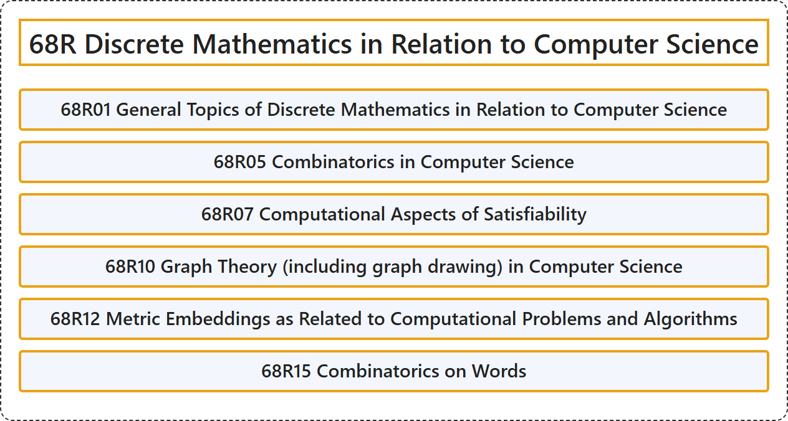

# 68R Discrete Mathematics in Relation to Computer Science

## Classification

## Glossary

| Term | Definition | 中文翻译 | Source |
|---|---|---|---|
| **68R Discrete Mathematics in Relation to Computer Science** 与计算机科学相关的离散数学 | (No definition) | （无定义） | [Associate Editors of Mathematical Reviews and zbMATH, 2020](https://msc2020.org/) |
| **68R01 General Topics of Discrete Mathematics in Relation to Computer Science** 与计算机科学相关的离散数学一般专题 | (No definition) | （无定义） | [Associate Editors of Mathematical Reviews and zbMATH, 2020](https://msc2020.org/) |
| **68R05 Combinatorics in Computer Science** 计算机科学中的组合学 | (No definition) | （无定义） | [Associate Editors of Mathematical Reviews and zbMATH, 2020](https://msc2020.org/) |
| **68R07 Computational Aspects of Satisfiability** 可满足性的计算方面 | (No definition) | （无定义） | [Associate Editors of Mathematical Reviews and zbMATH, 2020](https://msc2020.org/) |
| **68R10 Graph Theory (including graph drawing) in Computer Science** 计算机科学中的图论（包括图的绘制） | (No definition) | （无定义） | [Associate Editors of Mathematical Reviews and zbMATH, 2020](https://msc2020.org/) |
| **68R12 Metric Embeddings as Related to Computational Problems and Algorithms** 与计算问题和算法相关的度量嵌入 | (No definition) | （无定义） | [Associate Editors of Mathematical Reviews and zbMATH, 2020](https://msc2020.org/) |
| **68R15 Combinatorics on Words** 单词组合学 | (No definition) | （无定义） | [Associate Editors of Mathematical Reviews and zbMATH, 2020](https://msc2020.org/) |

## References

Associate Editors of Mathematical Reviews and zbMATH. (2020). *MSC2020: Mathematics Subject Classification system*. Retrieved October 27, 2026, from <https://msc2020.org/>
