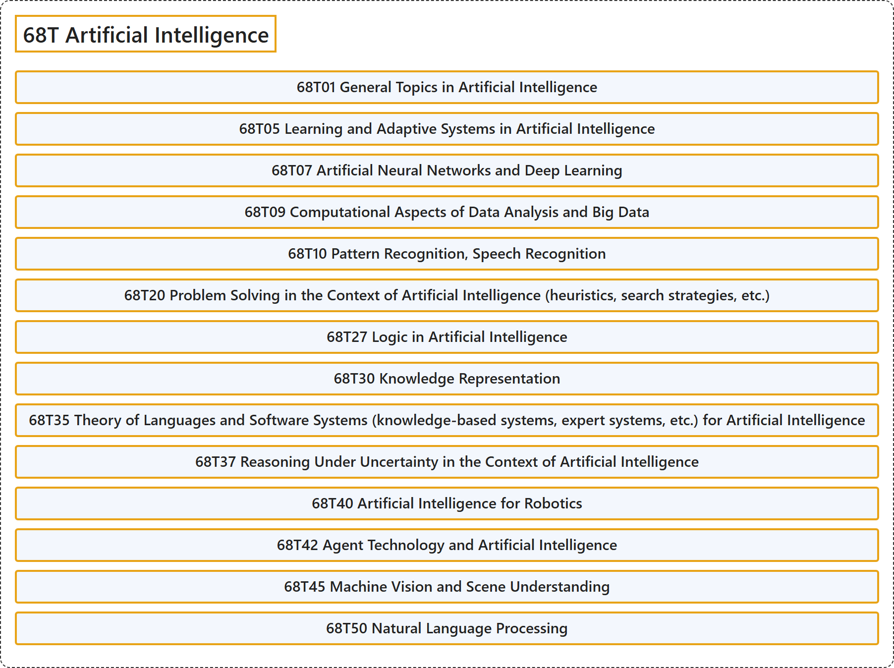

# 68T Artificial Intelligence

## Classification

## Glossary

| Term | Definition | 中文翻译 | Source |
|---|---|---|---|
| **68T Artificial Intelligence** 人工智能 | (No definition) | （无定义） | [Associate Editors of Mathematical Reviews and zbMATH, 2020](https://msc2020.org/) |
| **68T01 General Topics in Artificial Intelligence** 人工智能的一般专题 | (No definition) | （无定义） | [Associate Editors of Mathematical Reviews and zbMATH, 2020](https://msc2020.org/) |
| **68T05 Learning and Adaptive Systems in Artificial Intelligence** 人工智能中的学习与自适应系统 | (No definition) | （无定义） | [Associate Editors of Mathematical Reviews and zbMATH, 2020](https://msc2020.org/) |
| **68T07 Artificial Neural Networks and Deep Learning** 人工神经网络与深度学习 | (No definition) | （无定义） | [Associate Editors of Mathematical Reviews and zbMATH, 2020](https://msc2020.org/) |
| **68T09 Computational Aspects of Data Analysis and Big Data** 数据分析与大数据的计算方面 | (No definition) | （无定义） | [Associate Editors of Mathematical Reviews and zbMATH, 2020](https://msc2020.org/) |
| **68T10 Pattern Recognition, Speech Recognition** 模式识别、语音识别 | (No definition) | （无定义） | [Associate Editors of Mathematical Reviews and zbMATH, 2020](https://msc2020.org/) |
| **68T20 Problem Solving in the Context of Artificial Intelligence (heuristics, search strategies, etc.)** 人工智能中的问题求解（启发式、搜索策略等） | (No definition) | （无定义） | [Associate Editors of Mathematical Reviews and zbMATH, 2020](https://msc2020.org/) |
| **68T27 Logic in Artificial Intelligence** 人工智能中的逻辑 | (No definition) | （无定义） | [Associate Editors of Mathematical Reviews and zbMATH, 2020](https://msc2020.org/) |
| **68T30 Knowledge Representation** 知识表示 | (No definition) | （无定义） | [Associate Editors of Mathematical Reviews and zbMATH, 2020](https://msc2020.org/) |
| **68T35 Theory of Languages and Software Systems (knowledge-based systems, expert systems, etc.) for Artificial Intelligence** 人工智能的语言与软件系统理论（基于知识的系统、专家系统等） | (No definition) | （无定义） | [Associate Editors of Mathematical Reviews and zbMATH, 2020](https://msc2020.org/) |
| **68T37 Reasoning Under Uncertainty in the Context of Artificial Intelligence** 人工智能中的不确定性推理 | (No definition) | （无定义） | [Associate Editors of Mathematical Reviews and zbMATH, 2020](https://msc2020.org/) |
| **68T40 Artificial Intelligence for Robotics** 机器人人工智能 | (No definition) | （无定义） | [Associate Editors of Mathematical Reviews and zbMATH, 2020](https://msc2020.org/) |
| **68T42 Agent Technology and Artificial Intelligence** 智能体技术与人工智能 | (No definition) | （无定义） | [Associate Editors of Mathematical Reviews and zbMATH, 2020](https://msc2020.org/) |
| **68T45 Machine Vision and Scene Understanding** 机器视觉与场景理解 | (No definition) | （无定义） | [Associate Editors of Mathematical Reviews and zbMATH, 2020](https://msc2020.org/) |
| **68T50 Natural Language Processing** 自然语言处理 | (No definition) | （无定义） | [Associate Editors of Mathematical Reviews and zbMATH, 2020](https://msc2020.org/) |

## References

Associate Editors of Mathematical Reviews and zbMATH. (2020). *MSC2020: Mathematics Subject Classification system*. Retrieved October 27, 2026, from <https://msc2020.org/>
