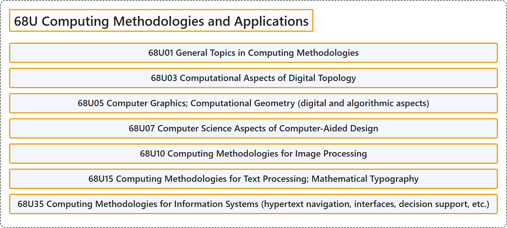

# 68U Computing Methodologies and Applications

## Classification

## Glossary

| Term | Definition | 中文翻译 | Source |
|---|---|---|---|
| **68U Computing Methodologies and Applications** 计算方法与应用 | (No definition) | （无定义） | [Associate Editors of Mathematical Reviews and zbMATH, 2020](https://msc2020.org/) |
| **68U01 General Topics in Computing Methodologies** 计算方法学的一般专题 | (No definition) | （无定义） | [Associate Editors of Mathematical Reviews and zbMATH, 2020](https://msc2020.org/) |
| **68U03 Computational Aspects of Digital Topology** 数字拓扑的计算方面 | (No definition) | （无定义） | [Associate Editors of Mathematical Reviews and zbMATH, 2020](https://msc2020.org/) |
| **68U05 Computer Graphics; Computational Geometry (digital and algorithmic aspects)** 计算机图形学；计算几何（数字与算法方面） | (No definition) | （无定义） | [Associate Editors of Mathematical Reviews and zbMATH, 2020](https://msc2020.org/) |
| **68U07 Computer Science Aspects of Computer-Aided Design** 计算机辅助设计的计算机科学方面 | (No definition) | （无定义） | [Associate Editors of Mathematical Reviews and zbMATH, 2020](https://msc2020.org/) |
| **68U10 Computing Methodologies for Image Processing** 图像处理的计算方法学 | (No definition) | （无定义） | [Associate Editors of Mathematical Reviews and zbMATH, 2020](https://msc2020.org/) |
| **68U15 Computing Methodologies for Text Processing; Mathematical Typography** 文本处理的计算方法学；数学排版 | (No definition) | （无定义） | [Associate Editors of Mathematical Reviews and zbMATH, 2020](https://msc2020.org/) |
| **68U35 Computing Methodologies for Information Systems (hypertext navigation, interfaces, decision support, etc.)** 信息系统的计算方法学（超文本导航、界面、决策支持等） | (No definition) | （无定义） | [Associate Editors of Mathematical Reviews and zbMATH, 2020](https://msc2020.org/) |

## References

Associate Editors of Mathematical Reviews and zbMATH. (2020). *MSC2020: Mathematics Subject Classification system*. Retrieved October 27, 2026, from <https://msc2020.org/>
