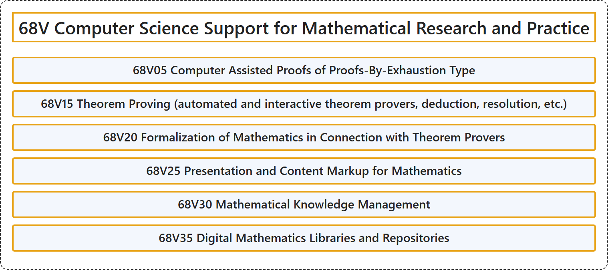

# 68V Computer Science Support for Mathematical Research and Practice

## Classification

## Glossary

| Term | Definition | 中文翻译 | Source |
|---|---|---|---|
| **68V Computer Science Support for Mathematical Research and Practice** 对数学研究与实践的计算机科学支持 | (No definition) | （无定义） | [Associate Editors of Mathematical Reviews and zbMATH, 2020](https://msc2020.org/) |
| **68V05 Computer Assisted Proofs of Proofs-By-Exhaustion Type** 穷举型证明的计算机辅助证明 | (No definition) | （无定义） | [Associate Editors of Mathematical Reviews and zbMATH, 2020](https://msc2020.org/) |
| **68V15 Theorem Proving (automated and interactive theorem provers, deduction, resolution, etc.)** 定理证明（自动与交互式定理证明器、演绎、归结等） | (No definition) | （无定义） | [Associate Editors of Mathematical Reviews and zbMATH, 2020](https://msc2020.org/) |
| **68V20 Formalization of Mathematics in Connection with Theorem Provers** 与定理证明器相关的数学形式化 | (No definition) | （无定义） | [Associate Editors of Mathematical Reviews and zbMATH, 2020](https://msc2020.org/) |
| **68V25 Presentation and Content Markup for Mathematics** 数学的表示与内容标记 | (No definition) | （无定义） | [Associate Editors of Mathematical Reviews and zbMATH, 2020](https://msc2020.org/) |
| **68V30 Mathematical Knowledge Management** 数学知识管理 | (No definition) | （无定义） | [Associate Editors of Mathematical Reviews and zbMATH, 2020](https://msc2020.org/) |
| **68V35 Digital Mathematics Libraries and Repositories** 数字数学图书馆与数学资源库 | (No definition) | （无定义） | [Associate Editors of Mathematical Reviews and zbMATH, 2020](https://msc2020.org/) |

## References

Associate Editors of Mathematical Reviews and zbMATH. (2020). *MSC2020: Mathematics Subject Classification system*. Retrieved October 27, 2026, from <https://msc2020.org/>
