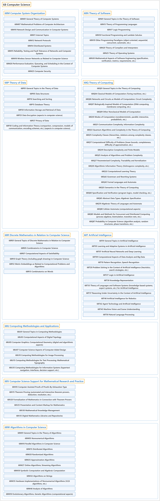

# 68 Computer Science

## Classification

## Glossary

| Term | Definition | 中文翻译 | Source |
|---|---|---|---|
| **68 Computer Science** 计算机科学 | (context) "An algorithm is a **specific set of instructions for carrying out a procedure or solving a problem**, usually with the requirement that the procedure terminate at some point." | （语境）算法是**执行某个过程或解决某个问题的一组具体指令**，通常要求该过程在某一时刻终止。 | [Weisstein, n.d., "Algorithm" entry, para. 1](https://mathworld.wolfram.com/Algorithm.html#:~:text=An%20algorithm%20is%20a%20specific%20set%20of%20instructions) |
| **[68M Computer System Organization](68m-computer-system-organization.md)** 计算机系统组织 | (No definition) | （无定义） | [Associate Editors of Mathematical Reviews and zbMATH, 2020](https://msc2020.org/) |
| **[68N Theory of Software](68n-theory-of-software.md)** 软件理论 | (No definition) | （无定义） | [Associate Editors of Mathematical Reviews and zbMATH, 2020](https://msc2020.org/) |
| **[68P Theory of Data](68p-theory-of-data.md)** 数据理论 | (No definition) | （无定义） | [Associate Editors of Mathematical Reviews and zbMATH, 2020](https://msc2020.org/) |
| **[68Q Theory of Computing](68q-theory-of-computing.md)** 计算理论 | (No definition) | （无定义） | [Associate Editors of Mathematical Reviews and zbMATH, 2020](https://msc2020.org/) |
| **[68R Discrete Mathematics in Relation to Computer Science](68r-discrete-mathematics-in-relation-to-computer-science.md)** 与计算机科学相关的离散数学 | (No definition) | （无定义） | [Associate Editors of Mathematical Reviews and zbMATH, 2020](https://msc2020.org/) |
| **[68T Artificial Intelligence](68t-artificial-intelligence.md)** 人工智能 | (No definition) | （无定义） | [Associate Editors of Mathematical Reviews and zbMATH, 2020](https://msc2020.org/) |
| **[68U Computing Methodologies and Applications](68u-computing-methodologies-and-applications.md)** 计算方法与应用 | (No definition) | （无定义） | [Associate Editors of Mathematical Reviews and zbMATH, 2020](https://msc2020.org/) |
| **[68V Computer Science Support for Mathematical Research and Practice](68v-computer-science-support-for-mathematical-research-and-pract.md)** 对数学研究与实践的计算机科学支持 | (No definition) | （无定义） | [Associate Editors of Mathematical Reviews and zbMATH, 2020](https://msc2020.org/) |
| **[68W Algorithms in Computer Science](68w-algorithms-in-computer-science.md)** 计算机科学中的算法 | (No definition) | （无定义） | [Associate Editors of Mathematical Reviews and zbMATH, 2020](https://msc2020.org/) |

## References

Associate Editors of Mathematical Reviews and zbMATH. (2020). *MSC2020: Mathematics Subject Classification system*. Retrieved October 27, 2026, from <https://msc2020.org/>

Weisstein, E. W. (n.d.). *Algorithm*. MathWorld: A Wolfram Resource. Retrieved October 27, 2026, from <https://mathworld.wolfram.com/Algorithm.html>
