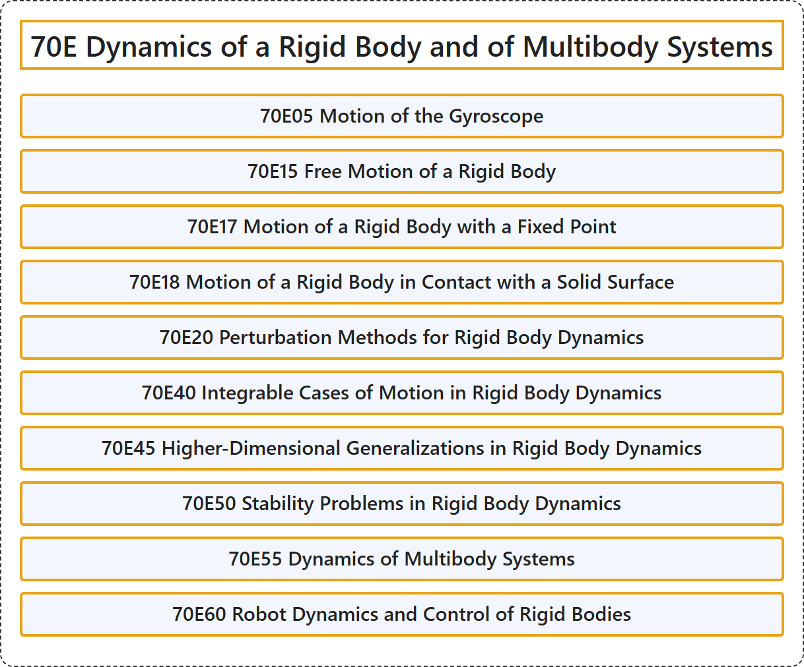

# 70E Dynamics of a Rigid Body and of Multibody Systems

## Classification

## Glossary

| Term | Definition | 中文翻译 | Source |
|---|---|---|---|
| **70E Dynamics of a Rigid Body and of Multibody Systems** 刚体与多体系统的动力学 | (No definition) | （无定义） | [Associate Editors of Mathematical Reviews and zbMATH, 2020](https://msc2020.org/) |
| **70E05 Motion of the Gyroscope** 陀螺的运动 | (No definition) | （无定义） | [Associate Editors of Mathematical Reviews and zbMATH, 2020](https://msc2020.org/) |
| **70E15 Free Motion of a Rigid Body** 刚体的自由运动 | (No definition) | （无定义） | [Associate Editors of Mathematical Reviews and zbMATH, 2020](https://msc2020.org/) |
| **70E17 Motion of a Rigid Body with a Fixed Point** 有固定点的刚体运动 | (No definition) | （无定义） | [Associate Editors of Mathematical Reviews and zbMATH, 2020](https://msc2020.org/) |
| **70E18 Motion of a Rigid Body in Contact with a Solid Surface** 与固体表面接触的刚体运动 | (No definition) | （无定义） | [Associate Editors of Mathematical Reviews and zbMATH, 2020](https://msc2020.org/) |
| **70E20 Perturbation Methods for Rigid Body Dynamics** 刚体动力学的摄动方法 | (No definition) | （无定义） | [Associate Editors of Mathematical Reviews and zbMATH, 2020](https://msc2020.org/) |
| **70E40 Integrable Cases of Motion in Rigid Body Dynamics** 刚体动力学中运动的可积情形 | (No definition) | （无定义） | [Associate Editors of Mathematical Reviews and zbMATH, 2020](https://msc2020.org/) |
| **70E45 Higher-Dimensional Generalizations in Rigid Body Dynamics** 刚体动力学中的高维推广 | (No definition) | （无定义） | [Associate Editors of Mathematical Reviews and zbMATH, 2020](https://msc2020.org/) |
| **70E50 Stability Problems in Rigid Body Dynamics** 刚体动力学中的稳定性问题 | (No definition) | （无定义） | [Associate Editors of Mathematical Reviews and zbMATH, 2020](https://msc2020.org/) |
| **70E55 Dynamics of Multibody Systems** 多体系统动力学 | (No definition) | （无定义） | [Associate Editors of Mathematical Reviews and zbMATH, 2020](https://msc2020.org/) |
| **70E60 Robot Dynamics and Control of Rigid Bodies** 机器人动力学与刚体控制 | (No definition) | （无定义） | [Associate Editors of Mathematical Reviews and zbMATH, 2020](https://msc2020.org/) |

## References

Associate Editors of Mathematical Reviews and zbMATH. (2020). *MSC2020: Mathematics Subject Classification system*. Retrieved October 27, 2026, from <https://msc2020.org/>
