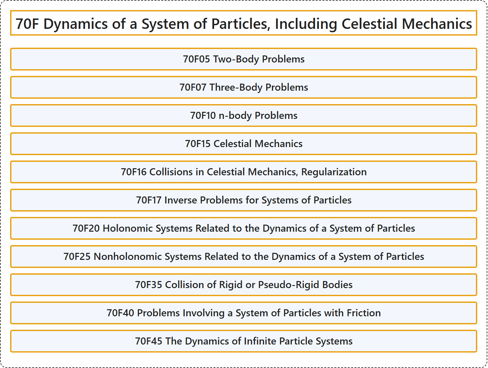

# 70F Dynamics of a System of Particles, Including Celestial Mechanics

## Classification

## Glossary

| Term | Definition | 中文翻译 | Source |
|---|---|---|---|
| **70F Dynamics of a System of Particles, Including Celestial Mechanics** 质点系动力学，包括天体力学 | (No definition) | （无定义） | [Associate Editors of Mathematical Reviews and zbMATH, 2020](https://msc2020.org/) |
| **70F05 Two-Body Problems** 二体问题 | (No definition) | （无定义） | [Associate Editors of Mathematical Reviews and zbMATH, 2020](https://msc2020.org/) |
| **70F07 Three-Body Problems** 三体问题 | (No definition) | （无定义） | [Associate Editors of Mathematical Reviews and zbMATH, 2020](https://msc2020.org/) |
| **70F10 n-body Problems** n 体问题 | (No definition) | （无定义） | [Associate Editors of Mathematical Reviews and zbMATH, 2020](https://msc2020.org/) |
| **70F15 Celestial Mechanics** 天体力学 | (No definition) | （无定义） | [Associate Editors of Mathematical Reviews and zbMATH, 2020](https://msc2020.org/) |
| **70F16 Collisions in Celestial Mechanics, Regularization** 天体力学中的碰撞、正则化 | (No definition) | （无定义） | [Associate Editors of Mathematical Reviews and zbMATH, 2020](https://msc2020.org/) |
| **70F17 Inverse Problems for Systems of Particles** 质点系的反问题 | (No definition) | （无定义） | [Associate Editors of Mathematical Reviews and zbMATH, 2020](https://msc2020.org/) |
| **70F20 Holonomic Systems Related to the Dynamics of a System of Particles** 与质点系动力学相关的完整系统 | (No definition) | （无定义） | [Associate Editors of Mathematical Reviews and zbMATH, 2020](https://msc2020.org/) |
| **70F25 Nonholonomic Systems Related to the Dynamics of a System of Particles** 与质点系动力学相关的非完整系统 | (No definition) | （无定义） | [Associate Editors of Mathematical Reviews and zbMATH, 2020](https://msc2020.org/) |
| **70F35 Collision of Rigid or Pseudo-Rigid Bodies** 刚体或拟刚体的碰撞 | (No definition) | （无定义） | [Associate Editors of Mathematical Reviews and zbMATH, 2020](https://msc2020.org/) |
| **70F40 Problems Involving a System of Particles with Friction** 含摩擦的质点系问题 | (No definition) | （无定义） | [Associate Editors of Mathematical Reviews and zbMATH, 2020](https://msc2020.org/) |
| **70F45 The Dynamics of Infinite Particle Systems** 无限质点系的动力学 | (No definition) | （无定义） | [Associate Editors of Mathematical Reviews and zbMATH, 2020](https://msc2020.org/) |

## References

Associate Editors of Mathematical Reviews and zbMATH. (2020). *MSC2020: Mathematics Subject Classification system*. Retrieved October 27, 2026, from <https://msc2020.org/>
