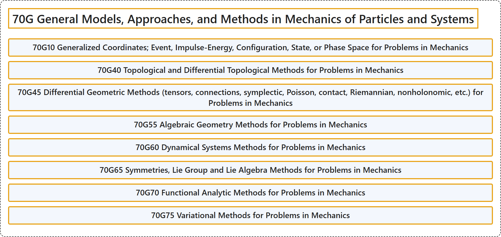

# 70G General Models, Approaches, and Methods in Mechanics of Particles and Systems

## Classification

## Glossary

| Term | Definition | 中文翻译 | Source |
|---|---|---|---|
| **70G General Models, Approaches, and Methods in Mechanics of Particles and Systems** 质点与质点系力学中的一般模型、途径与方法 | (No definition) | （无定义） | [Associate Editors of Mathematical Reviews and zbMATH, 2020](https://msc2020.org/) |
| **70G10 Generalized Coordinates; Event, Impulse-Energy, Configuration, State, or Phase Space for Problems in Mechanics** 力学问题中的广义坐标；事件空间、冲量能量空间、位形空间、状态空间或相空间 | (No definition) | （无定义） | [Associate Editors of Mathematical Reviews and zbMATH, 2020](https://msc2020.org/) |
| **70G40 Topological and Differential Topological Methods for Problems in Mechanics** 力学问题的拓扑与微分拓扑方法 | (No definition) | （无定义） | [Associate Editors of Mathematical Reviews and zbMATH, 2020](https://msc2020.org/) |
| **70G45 Differential Geometric Methods (tensors, connections, symplectic, Poisson, contact, Riemannian, nonholonomic, etc.) for Problems in Mechanics** 力学问题的微分几何方法（张量、联络、辛、泊松、接触、黎曼、非完整等） | (No definition) | （无定义） | [Associate Editors of Mathematical Reviews and zbMATH, 2020](https://msc2020.org/) |
| **70G55 Algebraic Geometry Methods for Problems in Mechanics** 力学问题的代数几何方法 | (No definition) | （无定义） | [Associate Editors of Mathematical Reviews and zbMATH, 2020](https://msc2020.org/) |
| **70G60 Dynamical Systems Methods for Problems in Mechanics** 力学问题的动力系统方法 | (No definition) | （无定义） | [Associate Editors of Mathematical Reviews and zbMATH, 2020](https://msc2020.org/) |
| **70G65 Symmetries, Lie Group and Lie Algebra Methods for Problems in Mechanics** 力学问题的对称性、李群与李代数方法 | (No definition) | （无定义） | [Associate Editors of Mathematical Reviews and zbMATH, 2020](https://msc2020.org/) |
| **70G70 Functional Analytic Methods for Problems in Mechanics** 力学问题的泛函分析方法 | (No definition) | （无定义） | [Associate Editors of Mathematical Reviews and zbMATH, 2020](https://msc2020.org/) |
| **70G75 Variational Methods for Problems in Mechanics** 力学问题的变分方法 | (No definition) | （无定义） | [Associate Editors of Mathematical Reviews and zbMATH, 2020](https://msc2020.org/) |

## References

Associate Editors of Mathematical Reviews and zbMATH. (2020). *MSC2020: Mathematics Subject Classification system*. Retrieved October 27, 2026, from <https://msc2020.org/>
