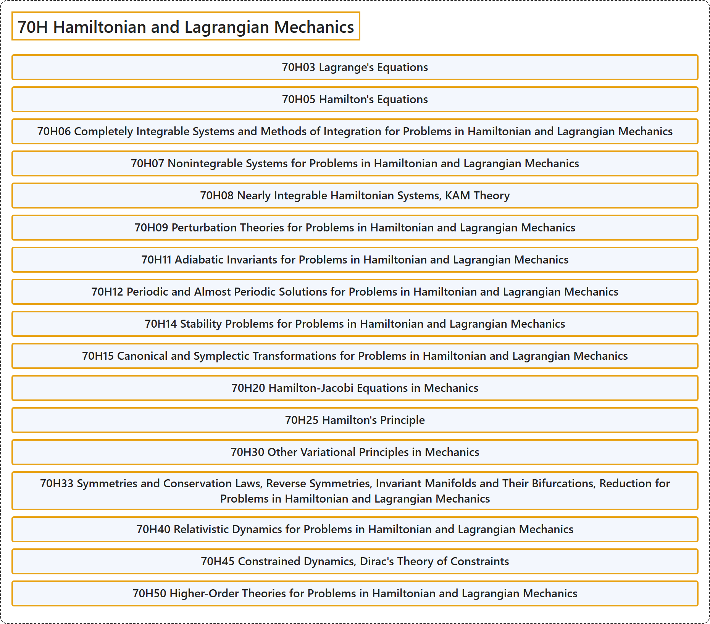

# 70H Hamiltonian and Lagrangian Mechanics

## Classification

## Glossary

| Term | Definition | 中文翻译 | Source |
|---|---|---|---|
| **70H Hamiltonian and Lagrangian Mechanics** 哈密顿力学与拉格朗日力学 | (No definition) | （无定义） | [Associate Editors of Mathematical Reviews and zbMATH, 2020](https://msc2020.org/) |
| **70H03 Lagrange's Equations** 拉格朗日方程 | (No definition) | （无定义） | [Associate Editors of Mathematical Reviews and zbMATH, 2020](https://msc2020.org/) |
| **70H05 Hamilton's Equations** 哈密顿方程 | (No definition) | （无定义） | [Associate Editors of Mathematical Reviews and zbMATH, 2020](https://msc2020.org/) |
| **70H06 Completely Integrable Systems and Methods of Integration for Problems in Hamiltonian and Lagrangian Mechanics** 哈密顿力学与拉格朗日力学问题中的完全可积系统与积分方法 | (No definition) | （无定义） | [Associate Editors of Mathematical Reviews and zbMATH, 2020](https://msc2020.org/) |
| **70H07 Nonintegrable Systems for Problems in Hamiltonian and Lagrangian Mechanics** 哈密顿力学与拉格朗日力学问题中的不可积系统 | (No definition) | （无定义） | [Associate Editors of Mathematical Reviews and zbMATH, 2020](https://msc2020.org/) |
| **70H08 Nearly Integrable Hamiltonian Systems, KAM Theory** 近可积哈密顿系统、KAM 理论 | (No definition) | （无定义） | [Associate Editors of Mathematical Reviews and zbMATH, 2020](https://msc2020.org/) |
| **70H09 Perturbation Theories for Problems in Hamiltonian and Lagrangian Mechanics** 哈密顿力学与拉格朗日力学问题的摄动理论 | (No definition) | （无定义） | [Associate Editors of Mathematical Reviews and zbMATH, 2020](https://msc2020.org/) |
| **70H11 Adiabatic Invariants for Problems in Hamiltonian and Lagrangian Mechanics** 哈密顿力学与拉格朗日力学问题的绝热不变量 | (No definition) | （无定义） | [Associate Editors of Mathematical Reviews and zbMATH, 2020](https://msc2020.org/) |
| **70H12 Periodic and Almost Periodic Solutions for Problems in Hamiltonian and Lagrangian Mechanics** 哈密顿力学与拉格朗日力学问题的周期解与概周期解 | (No definition) | （无定义） | [Associate Editors of Mathematical Reviews and zbMATH, 2020](https://msc2020.org/) |
| **70H14 Stability Problems for Problems in Hamiltonian and Lagrangian Mechanics** 哈密顿力学与拉格朗日力学问题的稳定性问题 | (No definition) | （无定义） | [Associate Editors of Mathematical Reviews and zbMATH, 2020](https://msc2020.org/) |
| **70H15 Canonical and Symplectic Transformations for Problems in Hamiltonian and Lagrangian Mechanics** 哈密顿力学与拉格朗日力学问题的正则变换与辛变换 | (No definition) | （无定义） | [Associate Editors of Mathematical Reviews and zbMATH, 2020](https://msc2020.org/) |
| **70H20 Hamilton-Jacobi Equations in Mechanics** 力学中的哈密顿-雅可比方程 | (No definition) | （无定义） | [Associate Editors of Mathematical Reviews and zbMATH, 2020](https://msc2020.org/) |
| **70H25 Hamilton's Principle** 哈密顿原理 | (No definition) | （无定义） | [Associate Editors of Mathematical Reviews and zbMATH, 2020](https://msc2020.org/) |
| **70H30 Other Variational Principles in Mechanics** 力学中的其他变分原理 | (No definition) | （无定义） | [Associate Editors of Mathematical Reviews and zbMATH, 2020](https://msc2020.org/) |
| **70H33 Symmetries and Conservation Laws, Reverse Symmetries, Invariant Manifolds and Their Bifurcations, Reduction for Problems in Hamiltonian and Lagrangian Mechanics** 哈密顿力学与拉格朗日力学问题中的对称性与守恒律、反向对称性、不变流形及其分岔、约化 | (No definition) | （无定义） | [Associate Editors of Mathematical Reviews and zbMATH, 2020](https://msc2020.org/) |
| **70H40 Relativistic Dynamics for Problems in Hamiltonian and Lagrangian Mechanics** 哈密顿力学与拉格朗日力学问题的相对论动力学 | (No definition) | （无定义） | [Associate Editors of Mathematical Reviews and zbMATH, 2020](https://msc2020.org/) |
| **70H45 Constrained Dynamics, Dirac's Theory of Constraints** 约束动力学、狄拉克约束理论 | (No definition) | （无定义） | [Associate Editors of Mathematical Reviews and zbMATH, 2020](https://msc2020.org/) |
| **70H50 Higher-Order Theories for Problems in Hamiltonian and Lagrangian Mechanics** 哈密顿力学与拉格朗日力学问题的高阶理论 | (No definition) | （无定义） | [Associate Editors of Mathematical Reviews and zbMATH, 2020](https://msc2020.org/) |

## References

Associate Editors of Mathematical Reviews and zbMATH. (2020). *MSC2020: Mathematics Subject Classification system*. Retrieved October 27, 2026, from <https://msc2020.org/>
