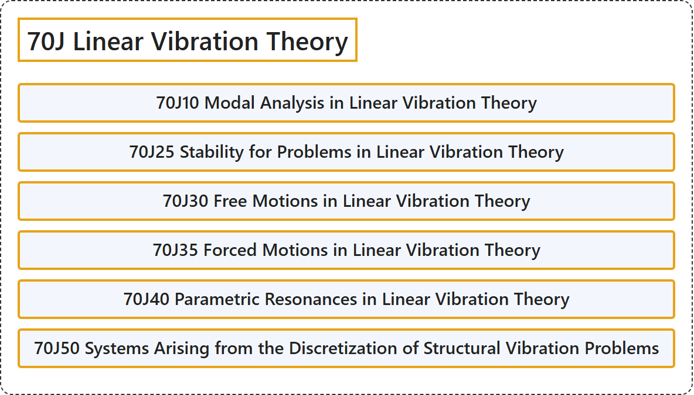

# 70J Linear Vibration Theory

## Classification

## Glossary

| Term | Definition | 中文翻译 | Source |
|---|---|---|---|
| **70J Linear Vibration Theory** 线性振动理论 | (No definition) | （无定义） | [Associate Editors of Mathematical Reviews and zbMATH, 2020](https://msc2020.org/) |
| **70J10 Modal Analysis in Linear Vibration Theory** 线性振动理论中的模态分析 | (No definition) | （无定义） | [Associate Editors of Mathematical Reviews and zbMATH, 2020](https://msc2020.org/) |
| **70J25 Stability for Problems in Linear Vibration Theory** 线性振动理论问题的稳定性 | (No definition) | （无定义） | [Associate Editors of Mathematical Reviews and zbMATH, 2020](https://msc2020.org/) |
| **70J30 Free Motions in Linear Vibration Theory** 线性振动理论中的自由运动 | (No definition) | （无定义） | [Associate Editors of Mathematical Reviews and zbMATH, 2020](https://msc2020.org/) |
| **70J35 Forced Motions in Linear Vibration Theory** 线性振动理论中的受迫运动 | (No definition) | （无定义） | [Associate Editors of Mathematical Reviews and zbMATH, 2020](https://msc2020.org/) |
| **70J40 Parametric Resonances in Linear Vibration Theory** 线性振动理论中的参数共振 | (No definition) | （无定义） | [Associate Editors of Mathematical Reviews and zbMATH, 2020](https://msc2020.org/) |
| **70J50 Systems Arising from the Discretization of Structural Vibration Problems** 由结构振动问题离散化产生的系统 | (No definition) | （无定义） | [Associate Editors of Mathematical Reviews and zbMATH, 2020](https://msc2020.org/) |

## References

Associate Editors of Mathematical Reviews and zbMATH. (2020). *MSC2020: Mathematics Subject Classification system*. Retrieved October 27, 2026, from <https://msc2020.org/>
