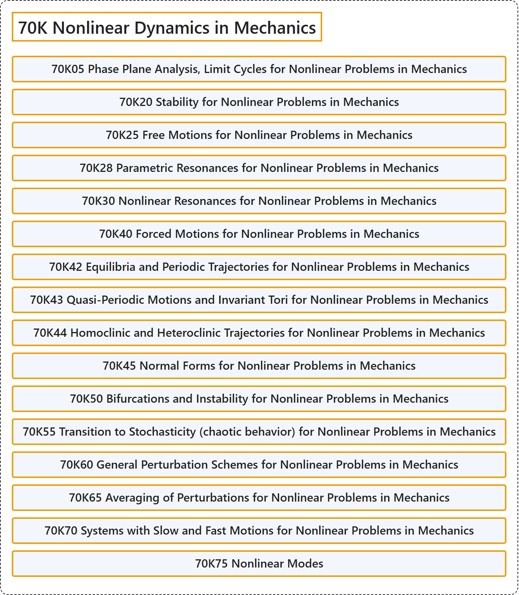

# 70K Nonlinear Dynamics in Mechanics

## Classification

## Glossary

| Term | Definition | 中文翻译 | Source |
|---|---|---|---|
| **70K Nonlinear Dynamics in Mechanics** 力学中的非线性动力学 | (No definition) | （无定义） | [Associate Editors of Mathematical Reviews and zbMATH, 2020](https://msc2020.org/) |
| **70K05 Phase Plane Analysis, Limit Cycles for Nonlinear Problems in Mechanics** 力学非线性问题的相平面分析、极限环 | (No definition) | （无定义） | [Associate Editors of Mathematical Reviews and zbMATH, 2020](https://msc2020.org/) |
| **70K20 Stability for Nonlinear Problems in Mechanics** 力学非线性问题的稳定性 | (No definition) | （无定义） | [Associate Editors of Mathematical Reviews and zbMATH, 2020](https://msc2020.org/) |
| **70K25 Free Motions for Nonlinear Problems in Mechanics** 力学非线性问题的自由运动 | (No definition) | （无定义） | [Associate Editors of Mathematical Reviews and zbMATH, 2020](https://msc2020.org/) |
| **70K28 Parametric Resonances for Nonlinear Problems in Mechanics** 力学非线性问题的参数共振 | (No definition) | （无定义） | [Associate Editors of Mathematical Reviews and zbMATH, 2020](https://msc2020.org/) |
| **70K30 Nonlinear Resonances for Nonlinear Problems in Mechanics** 力学非线性问题的非线性共振 | (No definition) | （无定义） | [Associate Editors of Mathematical Reviews and zbMATH, 2020](https://msc2020.org/) |
| **70K40 Forced Motions for Nonlinear Problems in Mechanics** 力学非线性问题的受迫运动 | (No definition) | （无定义） | [Associate Editors of Mathematical Reviews and zbMATH, 2020](https://msc2020.org/) |
| **70K42 Equilibria and Periodic Trajectories for Nonlinear Problems in Mechanics** 力学非线性问题的平衡点与周期轨道 | (No definition) | （无定义） | [Associate Editors of Mathematical Reviews and zbMATH, 2020](https://msc2020.org/) |
| **70K43 Quasi-Periodic Motions and Invariant Tori for Nonlinear Problems in Mechanics** 力学非线性问题的拟周期运动与不变环面 | (No definition) | （无定义） | [Associate Editors of Mathematical Reviews and zbMATH, 2020](https://msc2020.org/) |
| **70K44 Homoclinic and Heteroclinic Trajectories for Nonlinear Problems in Mechanics** 力学非线性问题的同宿轨道与异宿轨道 | (No definition) | （无定义） | [Associate Editors of Mathematical Reviews and zbMATH, 2020](https://msc2020.org/) |
| **70K45 Normal Forms for Nonlinear Problems in Mechanics** 力学非线性问题的范式 | (No definition) | （无定义） | [Associate Editors of Mathematical Reviews and zbMATH, 2020](https://msc2020.org/) |
| **70K50 Bifurcations and Instability for Nonlinear Problems in Mechanics** 力学非线性问题的分岔与不稳定性 | (No definition) | （无定义） | [Associate Editors of Mathematical Reviews and zbMATH, 2020](https://msc2020.org/) |
| **70K55 Transition to Stochasticity (chaotic behavior) for Nonlinear Problems in Mechanics** 力学非线性问题向随机性（混沌行为）的转变 | (No definition) | （无定义） | [Associate Editors of Mathematical Reviews and zbMATH, 2020](https://msc2020.org/) |
| **70K60 General Perturbation Schemes for Nonlinear Problems in Mechanics** 力学非线性问题的一般摄动格式 | (No definition) | （无定义） | [Associate Editors of Mathematical Reviews and zbMATH, 2020](https://msc2020.org/) |
| **70K65 Averaging of Perturbations for Nonlinear Problems in Mechanics** 力学非线性问题的摄动平均 | (No definition) | （无定义） | [Associate Editors of Mathematical Reviews and zbMATH, 2020](https://msc2020.org/) |
| **70K70 Systems with Slow and Fast Motions for Nonlinear Problems in Mechanics** 力学非线性问题中具有快慢运动的系统 | (No definition) | （无定义） | [Associate Editors of Mathematical Reviews and zbMATH, 2020](https://msc2020.org/) |
| **70K75 Nonlinear Modes** 非线性模态 | (No definition) | （无定义） | [Associate Editors of Mathematical Reviews and zbMATH, 2020](https://msc2020.org/) |

## References

Associate Editors of Mathematical Reviews and zbMATH. (2020). *MSC2020: Mathematics Subject Classification system*. Retrieved October 27, 2026, from <https://msc2020.org/>
