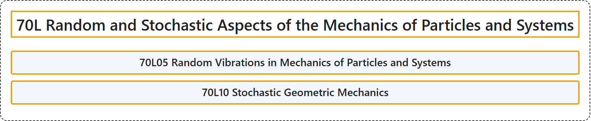

# 70L Random and Stochastic Aspects of the Mechanics of Particles and Systems

## Classification

## Glossary

| Term | Definition | 中文翻译 | Source |
|---|---|---|---|
| **70L Random and Stochastic Aspects of the Mechanics of Particles and Systems** 质点与质点系力学的随机方面 | (No definition) | （无定义） | [Associate Editors of Mathematical Reviews and zbMATH, 2020](https://msc2020.org/) |
| **70L05 Random Vibrations in Mechanics of Particles and Systems** 质点与系统力学中的随机振动 | (No definition) | （无定义） | [Associate Editors of Mathematical Reviews and zbMATH, 2020](https://msc2020.org/) |
| **70L10 Stochastic Geometric Mechanics** 随机几何力学 | (No definition) | （无定义） | [Associate Editors of Mathematical Reviews and zbMATH, 2020](https://msc2020.org/) |

## References

Associate Editors of Mathematical Reviews and zbMATH. (2020). *MSC2020: Mathematics Subject Classification system*. Retrieved October 27, 2026, from <https://msc2020.org/>
