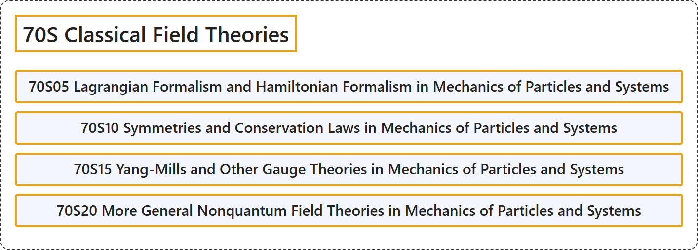

# 70S Classical Field Theories

## Classification

## Glossary

| Term | Definition | 中文翻译 | Source |
|---|---|---|---|
| **70S Classical Field Theories** 经典场论 | (No definition) | （无定义） | [Associate Editors of Mathematical Reviews and zbMATH, 2020](https://msc2020.org/) |
| **70S05 Lagrangian Formalism and Hamiltonian Formalism in Mechanics of Particles and Systems** 质点与系统力学中的拉格朗日形式与哈密顿形式 | (No definition) | （无定义） | [Associate Editors of Mathematical Reviews and zbMATH, 2020](https://msc2020.org/) |
| **70S10 Symmetries and Conservation Laws in Mechanics of Particles and Systems** 质点与系统力学中的对称性与守恒律 | (No definition) | （无定义） | [Associate Editors of Mathematical Reviews and zbMATH, 2020](https://msc2020.org/) |
| **70S15 Yang-Mills and Other Gauge Theories in Mechanics of Particles and Systems** 质点与系统力学中的杨-米尔斯理论及其他规范理论 | (No definition) | （无定义） | [Associate Editors of Mathematical Reviews and zbMATH, 2020](https://msc2020.org/) |
| **70S20 More General Nonquantum Field Theories in Mechanics of Particles and Systems** 质点与系统力学中更一般的非量子场论 | (No definition) | （无定义） | [Associate Editors of Mathematical Reviews and zbMATH, 2020](https://msc2020.org/) |

## References

Associate Editors of Mathematical Reviews and zbMATH. (2020). *MSC2020: Mathematics Subject Classification system*. Retrieved October 27, 2026, from <https://msc2020.org/>
