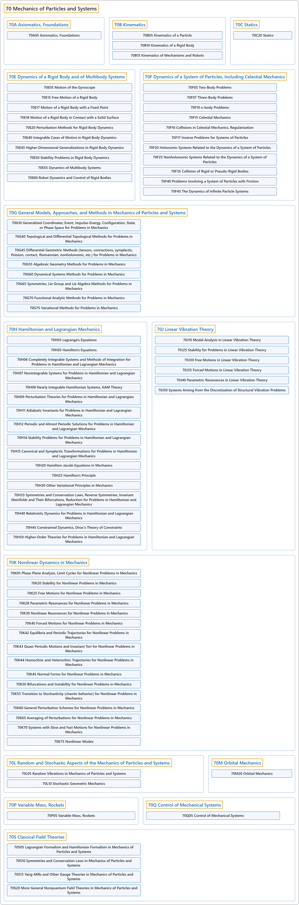

# 70 Mechanics of Particles and Systems

## Classification

## Glossary

| Term | Definition | 中文翻译 | Source |
|---|---|---|---|
| **70 Mechanics of Particles and Systems** 质点与质点系力学 | (Definition pending: no web source yet.) | （定义待补：暂无网页来源。） | Pending |
| **[70A Axiomatics, Foundations](70a-axiomatics-foundations.md)** 公理化、基础 | (No definition) | （无定义） | [Associate Editors of Mathematical Reviews and zbMATH, 2020](https://msc2020.org/) |
| **[70B Kinematics](70b-kinematics.md)** 运动学 | (No definition) | （无定义） | [Associate Editors of Mathematical Reviews and zbMATH, 2020](https://msc2020.org/) |
| **[70C Statics](70c-statics.md)** 静力学 | (No definition) | （无定义） | [Associate Editors of Mathematical Reviews and zbMATH, 2020](https://msc2020.org/) |
| **[70E Dynamics of a Rigid Body and of Multibody Systems](70e-dynamics-of-a-rigid-body-and-of-multibody-systems.md)** 刚体与多体系统的动力学 | (No definition) | （无定义） | [Associate Editors of Mathematical Reviews and zbMATH, 2020](https://msc2020.org/) |
| **[70F Dynamics of a System of Particles, Including Celestial Mechanics](70f-dynamics-of-a-system-of-particles-including-celestial-mechan.md)** 质点系动力学，包括天体力学 | (No definition) | （无定义） | [Associate Editors of Mathematical Reviews and zbMATH, 2020](https://msc2020.org/) |
| **[70G General Models, Approaches, and Methods in Mechanics of Particles and Systems](70g-general-models-approaches-and-methods-in-mechanics-of-partic.md)** 质点与质点系力学中的一般模型、途径与方法 | (No definition) | （无定义） | [Associate Editors of Mathematical Reviews and zbMATH, 2020](https://msc2020.org/) |
| **[70H Hamiltonian and Lagrangian Mechanics](70h-hamiltonian-and-lagrangian-mechanics.md)** 哈密顿力学与拉格朗日力学 | (No definition) | （无定义） | [Associate Editors of Mathematical Reviews and zbMATH, 2020](https://msc2020.org/) |
| **[70J Linear Vibration Theory](70j-linear-vibration-theory.md)** 线性振动理论 | (No definition) | （无定义） | [Associate Editors of Mathematical Reviews and zbMATH, 2020](https://msc2020.org/) |
| **[70K Nonlinear Dynamics in Mechanics](70k-nonlinear-dynamics-in-mechanics.md)** 力学中的非线性动力学 | (No definition) | （无定义） | [Associate Editors of Mathematical Reviews and zbMATH, 2020](https://msc2020.org/) |
| **[70L Random and Stochastic Aspects of the Mechanics of Particles and Systems](70l-random-and-stochastic-aspects-of-the-mechanics-of-particles.md)** 质点与质点系力学的随机方面 | (No definition) | （无定义） | [Associate Editors of Mathematical Reviews and zbMATH, 2020](https://msc2020.org/) |
| **[70M Orbital Mechanics](70m-orbital-mechanics.md)** 轨道力学 | (No definition) | （无定义） | [Associate Editors of Mathematical Reviews and zbMATH, 2020](https://msc2020.org/) |
| **[70P Variable Mass, Rockets](70p-variable-mass-rockets.md)** 变质量、火箭 | (No definition) | （无定义） | [Associate Editors of Mathematical Reviews and zbMATH, 2020](https://msc2020.org/) |
| **[70Q Control of Mechanical Systems](70q-control-of-mechanical-systems.md)** 机械系统的控制 | (No definition) | （无定义） | [Associate Editors of Mathematical Reviews and zbMATH, 2020](https://msc2020.org/) |
| **[70S Classical Field Theories](70s-classical-field-theories.md)** 经典场论 | (No definition) | （无定义） | [Associate Editors of Mathematical Reviews and zbMATH, 2020](https://msc2020.org/) |

## References

Associate Editors of Mathematical Reviews and zbMATH. (2020). *MSC2020: Mathematics Subject Classification system*. Retrieved October 27, 2026, from <https://msc2020.org/>
