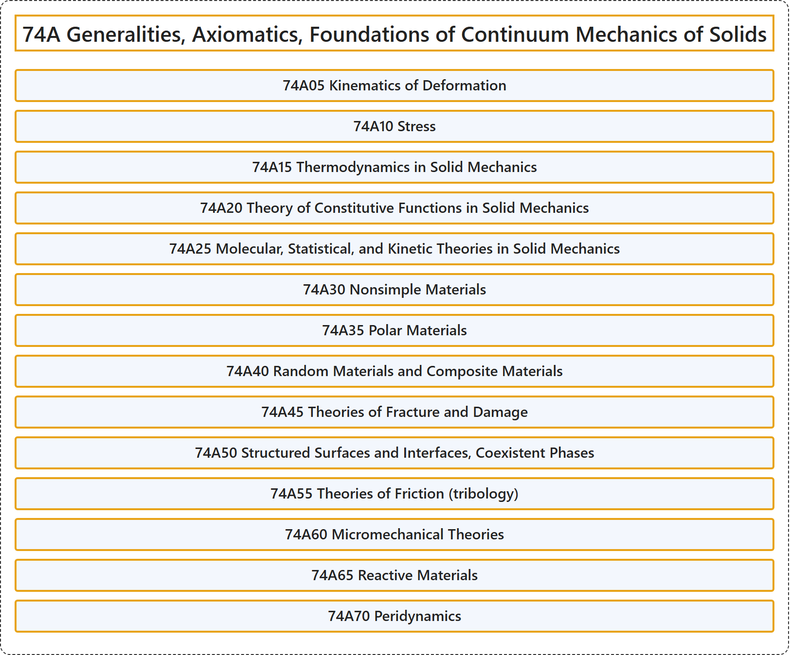

# 74A Generalities, Axiomatics, Foundations of Continuum Mechanics of Solids

## Classification

## Glossary

| Term | Definition | 中文翻译 | Source |
|---|---|---|---|
| **74A Generalities, Axiomatics, Foundations of Continuum Mechanics of Solids** 固体连续介质力学的一般性、公理化与基础 | (No definition) | （无定义） | [Associate Editors of Mathematical Reviews and zbMATH, 2020](https://msc2020.org/) |
| **74A05 Kinematics of Deformation** 变形运动学 | (No definition) | （无定义） | [Associate Editors of Mathematical Reviews and zbMATH, 2020](https://msc2020.org/) |
| **74A10 Stress** 应力 | (No definition) | （无定义） | [Associate Editors of Mathematical Reviews and zbMATH, 2020](https://msc2020.org/) |
| **74A15 Thermodynamics in Solid Mechanics** 固体力学中的热力学 | (No definition) | （无定义） | [Associate Editors of Mathematical Reviews and zbMATH, 2020](https://msc2020.org/) |
| **74A20 Theory of Constitutive Functions in Solid Mechanics** 固体力学中的本构函数理论 | (No definition) | （无定义） | [Associate Editors of Mathematical Reviews and zbMATH, 2020](https://msc2020.org/) |
| **74A25 Molecular, Statistical, and Kinetic Theories in Solid Mechanics** 固体力学中的分子理论、统计理论与动理学理论 | (No definition) | （无定义） | [Associate Editors of Mathematical Reviews and zbMATH, 2020](https://msc2020.org/) |
| **74A30 Nonsimple Materials** 非简单材料 | (No definition) | （无定义） | [Associate Editors of Mathematical Reviews and zbMATH, 2020](https://msc2020.org/) |
| **74A35 Polar Materials** 极性材料 | (No definition) | （无定义） | [Associate Editors of Mathematical Reviews and zbMATH, 2020](https://msc2020.org/) |
| **74A40 Random Materials and Composite Materials** 随机材料与复合材料 | (No definition) | （无定义） | [Associate Editors of Mathematical Reviews and zbMATH, 2020](https://msc2020.org/) |
| **74A45 Theories of Fracture and Damage** 断裂与损伤理论 | (No definition) | （无定义） | [Associate Editors of Mathematical Reviews and zbMATH, 2020](https://msc2020.org/) |
| **74A50 Structured Surfaces and Interfaces, Coexistent Phases** 结构化表面与界面、共存相 | (No definition) | （无定义） | [Associate Editors of Mathematical Reviews and zbMATH, 2020](https://msc2020.org/) |
| **74A55 Theories of Friction (tribology)** 摩擦理论（摩擦学） | (No definition) | （无定义） | [Associate Editors of Mathematical Reviews and zbMATH, 2020](https://msc2020.org/) |
| **74A60 Micromechanical Theories** 微观力学理论 | (No definition) | （无定义） | [Associate Editors of Mathematical Reviews and zbMATH, 2020](https://msc2020.org/) |
| **74A65 Reactive Materials** 反应性材料 | (No definition) | （无定义） | [Associate Editors of Mathematical Reviews and zbMATH, 2020](https://msc2020.org/) |
| **74A70 Peridynamics** 近场动力学 | (No definition) | （无定义） | [Associate Editors of Mathematical Reviews and zbMATH, 2020](https://msc2020.org/) |

## References

Associate Editors of Mathematical Reviews and zbMATH. (2020). *MSC2020: Mathematics Subject Classification system*. Retrieved October 27, 2026, from <https://msc2020.org/>
