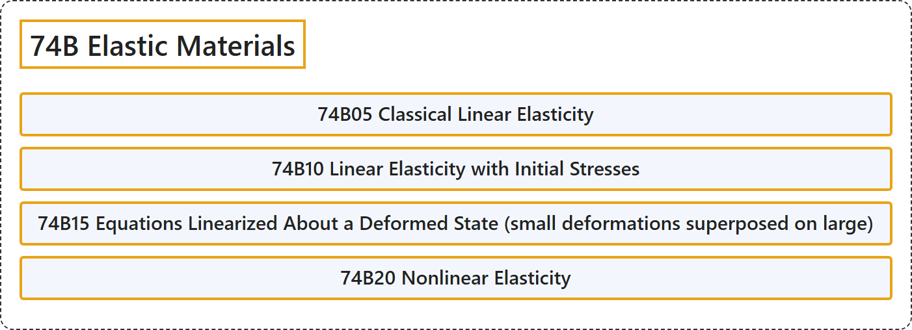

# 74B Elastic Materials

## Classification

## Glossary

| Term | Definition | 中文翻译 | Source |
|---|---|---|---|
| **74B Elastic Materials** 弹性材料 | (No definition) | （无定义） | [Associate Editors of Mathematical Reviews and zbMATH, 2020](https://msc2020.org/) |
| **74B05 Classical Linear Elasticity** 经典线性弹性理论 | (No definition) | （无定义） | [Associate Editors of Mathematical Reviews and zbMATH, 2020](https://msc2020.org/) |
| **74B10 Linear Elasticity with Initial Stresses** 含初应力的线性弹性理论 | (No definition) | （无定义） | [Associate Editors of Mathematical Reviews and zbMATH, 2020](https://msc2020.org/) |
| **74B15 Equations Linearized About a Deformed State (small deformations superposed on large)** 关于变形状态线性化的方程（大变形上叠加小变形） | (No definition) | （无定义） | [Associate Editors of Mathematical Reviews and zbMATH, 2020](https://msc2020.org/) |
| **74B20 Nonlinear Elasticity** 非线性弹性理论 | (No definition) | （无定义） | [Associate Editors of Mathematical Reviews and zbMATH, 2020](https://msc2020.org/) |

## References

Associate Editors of Mathematical Reviews and zbMATH. (2020). *MSC2020: Mathematics Subject Classification system*. Retrieved October 27, 2026, from <https://msc2020.org/>
