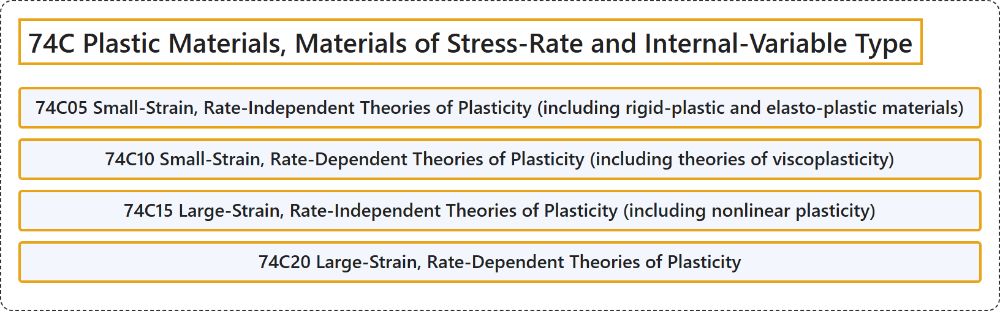

# 74C Plastic Materials, Materials of Stress-Rate and Internal-Variable Type

## Classification

## Glossary

| Term | Definition | 中文翻译 | Source |
|---|---|---|---|
| **74C Plastic Materials, Materials of Stress-Rate and Internal-Variable Type** 塑性材料、应力率型与内变量型材料 | (No definition) | （无定义） | [Associate Editors of Mathematical Reviews and zbMATH, 2020](https://msc2020.org/) |
| **74C05 Small-Strain, Rate-Independent Theories of Plasticity (including rigid-plastic and elasto-plastic materials)** 小应变、率无关塑性理论（包括刚塑性与弹塑性材料） | (No definition) | （无定义） | [Associate Editors of Mathematical Reviews and zbMATH, 2020](https://msc2020.org/) |
| **74C10 Small-Strain, Rate-Dependent Theories of Plasticity (including theories of viscoplasticity)** 小应变、率相关塑性理论（包括黏塑性理论） | (No definition) | （无定义） | [Associate Editors of Mathematical Reviews and zbMATH, 2020](https://msc2020.org/) |
| **74C15 Large-Strain, Rate-Independent Theories of Plasticity (including nonlinear plasticity)** 大应变、率无关塑性理论（包括非线性塑性） | (No definition) | （无定义） | [Associate Editors of Mathematical Reviews and zbMATH, 2020](https://msc2020.org/) |
| **74C20 Large-Strain, Rate-Dependent Theories of Plasticity** 大应变、率相关塑性理论 | (No definition) | （无定义） | [Associate Editors of Mathematical Reviews and zbMATH, 2020](https://msc2020.org/) |

## References

Associate Editors of Mathematical Reviews and zbMATH. (2020). *MSC2020: Mathematics Subject Classification system*. Retrieved October 27, 2026, from <https://msc2020.org/>
