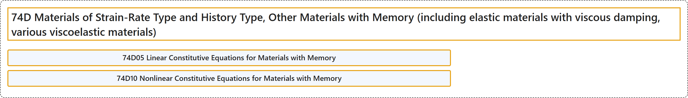

# 74D Materials of Strain-Rate Type and History Type, Other Materials with Memory (including elastic materials with viscous damping, various viscoelastic materials)

## Classification

## Glossary

| Term | Definition | 中文翻译 | Source |
|---|---|---|---|
| **74D Materials of Strain-Rate Type and History Type, Other Materials with Memory (including elastic materials with viscous damping, various viscoelastic materials)** 应变率型与历史型材料、其他记忆材料（包括带粘性阻尼的弹性材料、各种粘弹性材料） | (No definition) | （无定义） | [Associate Editors of Mathematical Reviews and zbMATH, 2020](https://msc2020.org/) |
| **74D05 Linear Constitutive Equations for Materials with Memory** 记忆材料的线性本构方程 | (No definition) | （无定义） | [Associate Editors of Mathematical Reviews and zbMATH, 2020](https://msc2020.org/) |
| **74D10 Nonlinear Constitutive Equations for Materials with Memory** 记忆材料的非线性本构方程 | (No definition) | （无定义） | [Associate Editors of Mathematical Reviews and zbMATH, 2020](https://msc2020.org/) |

## References

Associate Editors of Mathematical Reviews and zbMATH. (2020). *MSC2020: Mathematics Subject Classification system*. Retrieved October 27, 2026, from <https://msc2020.org/>
