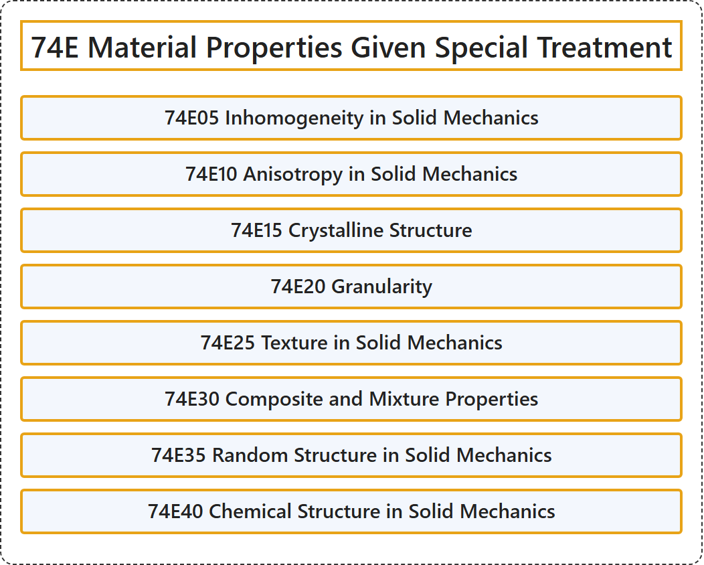

# 74E Material Properties Given Special Treatment

## Classification

## Glossary

| Term | Definition | 中文翻译 | Source |
|---|---|---|---|
| **74E Material Properties Given Special Treatment** 受特殊处理的材料性质 | (No definition) | （无定义） | [Associate Editors of Mathematical Reviews and zbMATH, 2020](https://msc2020.org/) |
| **74E05 Inhomogeneity in Solid Mechanics** 固体力学中的非均匀性 | (No definition) | （无定义） | [Associate Editors of Mathematical Reviews and zbMATH, 2020](https://msc2020.org/) |
| **74E10 Anisotropy in Solid Mechanics** 固体力学中的各向异性 | (No definition) | （无定义） | [Associate Editors of Mathematical Reviews and zbMATH, 2020](https://msc2020.org/) |
| **74E15 Crystalline Structure** 晶体结构 | (No definition) | （无定义） | [Associate Editors of Mathematical Reviews and zbMATH, 2020](https://msc2020.org/) |
| **74E20 Granularity** 颗粒性 | (No definition) | （无定义） | [Associate Editors of Mathematical Reviews and zbMATH, 2020](https://msc2020.org/) |
| **74E25 Texture in Solid Mechanics** 固体力学中的织构 | (No definition) | （无定义） | [Associate Editors of Mathematical Reviews and zbMATH, 2020](https://msc2020.org/) |
| **74E30 Composite and Mixture Properties** 复合与混合性质 | (No definition) | （无定义） | [Associate Editors of Mathematical Reviews and zbMATH, 2020](https://msc2020.org/) |
| **74E35 Random Structure in Solid Mechanics** 固体力学中的随机结构 | (No definition) | （无定义） | [Associate Editors of Mathematical Reviews and zbMATH, 2020](https://msc2020.org/) |
| **74E40 Chemical Structure in Solid Mechanics** 固体力学中的化学结构 | (No definition) | （无定义） | [Associate Editors of Mathematical Reviews and zbMATH, 2020](https://msc2020.org/) |

## References

Associate Editors of Mathematical Reviews and zbMATH. (2020). *MSC2020: Mathematics Subject Classification system*. Retrieved October 27, 2026, from <https://msc2020.org/>
