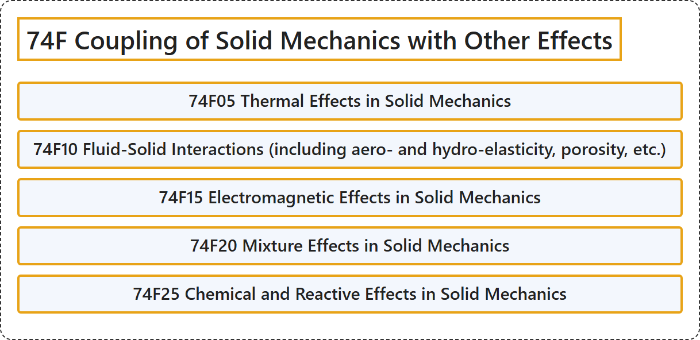

# 74F Coupling of Solid Mechanics with Other Effects

## Classification

## Glossary

| Term | Definition | 中文翻译 | Source |
|---|---|---|---|
| **74F Coupling of Solid Mechanics with Other Effects** 固体力学与其他效应的耦合 | (No definition) | （无定义） | [Associate Editors of Mathematical Reviews and zbMATH, 2020](https://msc2020.org/) |
| **74F05 Thermal Effects in Solid Mechanics** 固体力学中的热效应 | (No definition) | （无定义） | [Associate Editors of Mathematical Reviews and zbMATH, 2020](https://msc2020.org/) |
| **74F10 Fluid-Solid Interactions (including aero- and hydro-elasticity, porosity, etc.)** 流固耦合（包括气动弹性与水弹性、多孔性等） | (No definition) | （无定义） | [Associate Editors of Mathematical Reviews and zbMATH, 2020](https://msc2020.org/) |
| **74F15 Electromagnetic Effects in Solid Mechanics** 固体力学中的电磁效应 | (No definition) | （无定义） | [Associate Editors of Mathematical Reviews and zbMATH, 2020](https://msc2020.org/) |
| **74F20 Mixture Effects in Solid Mechanics** 固体力学中的混合效应 | (No definition) | （无定义） | [Associate Editors of Mathematical Reviews and zbMATH, 2020](https://msc2020.org/) |
| **74F25 Chemical and Reactive Effects in Solid Mechanics** 固体力学中的化学与反应效应 | (No definition) | （无定义） | [Associate Editors of Mathematical Reviews and zbMATH, 2020](https://msc2020.org/) |

## References

Associate Editors of Mathematical Reviews and zbMATH. (2020). *MSC2020: Mathematics Subject Classification system*. Retrieved October 27, 2026, from <https://msc2020.org/>
