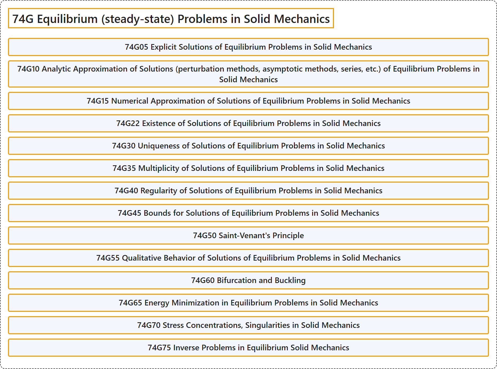

# 74G Equilibrium (steady-state) Problems in Solid Mechanics

## Classification

## Glossary

| Term | Definition | 中文翻译 | Source |
|---|---|---|---|
| **74G Equilibrium (steady-state) Problems in Solid Mechanics** 固体力学中的平衡（定常）问题 | (No definition) | （无定义） | [Associate Editors of Mathematical Reviews and zbMATH, 2020](https://msc2020.org/) |
| **74G05 Explicit Solutions of Equilibrium Problems in Solid Mechanics** 固体力学平衡问题的显式解 | (No definition) | （无定义） | [Associate Editors of Mathematical Reviews and zbMATH, 2020](https://msc2020.org/) |
| **74G10 Analytic Approximation of Solutions (perturbation methods, asymptotic methods, series, etc.) of Equilibrium Problems in Solid Mechanics** 固体力学平衡问题解的解析逼近（摄动方法、渐近方法、级数等） | (No definition) | （无定义） | [Associate Editors of Mathematical Reviews and zbMATH, 2020](https://msc2020.org/) |
| **74G15 Numerical Approximation of Solutions of Equilibrium Problems in Solid Mechanics** 固体力学平衡问题解的数值逼近 | (No definition) | （无定义） | [Associate Editors of Mathematical Reviews and zbMATH, 2020](https://msc2020.org/) |
| **74G22 Existence of Solutions of Equilibrium Problems in Solid Mechanics** 固体力学平衡问题解的存在性 | (No definition) | （无定义） | [Associate Editors of Mathematical Reviews and zbMATH, 2020](https://msc2020.org/) |
| **74G30 Uniqueness of Solutions of Equilibrium Problems in Solid Mechanics** 固体力学平衡问题解的唯一性 | (No definition) | （无定义） | [Associate Editors of Mathematical Reviews and zbMATH, 2020](https://msc2020.org/) |
| **74G35 Multiplicity of Solutions of Equilibrium Problems in Solid Mechanics** 固体力学平衡问题解的多重性 | (No definition) | （无定义） | [Associate Editors of Mathematical Reviews and zbMATH, 2020](https://msc2020.org/) |
| **74G40 Regularity of Solutions of Equilibrium Problems in Solid Mechanics** 固体力学平衡问题解的正则性 | (No definition) | （无定义） | [Associate Editors of Mathematical Reviews and zbMATH, 2020](https://msc2020.org/) |
| **74G45 Bounds for Solutions of Equilibrium Problems in Solid Mechanics** 固体力学平衡问题解的界 | (No definition) | （无定义） | [Associate Editors of Mathematical Reviews and zbMATH, 2020](https://msc2020.org/) |
| **74G50 Saint-Venant's Principle** 圣维南原理 | (No definition) | （无定义） | [Associate Editors of Mathematical Reviews and zbMATH, 2020](https://msc2020.org/) |
| **74G55 Qualitative Behavior of Solutions of Equilibrium Problems in Solid Mechanics** 固体力学平衡问题解的定性行为 | (No definition) | （无定义） | [Associate Editors of Mathematical Reviews and zbMATH, 2020](https://msc2020.org/) |
| **74G60 Bifurcation and Buckling** 分岔与屈曲 | (No definition) | （无定义） | [Associate Editors of Mathematical Reviews and zbMATH, 2020](https://msc2020.org/) |
| **74G65 Energy Minimization in Equilibrium Problems in Solid Mechanics** 固体力学平衡问题中的能量极小化 | (No definition) | （无定义） | [Associate Editors of Mathematical Reviews and zbMATH, 2020](https://msc2020.org/) |
| **74G70 Stress Concentrations, Singularities in Solid Mechanics** 固体力学中的应力集中、奇异性 | (No definition) | （无定义） | [Associate Editors of Mathematical Reviews and zbMATH, 2020](https://msc2020.org/) |
| **74G75 Inverse Problems in Equilibrium Solid Mechanics** 平衡固体力学中的反问题 | (No definition) | （无定义） | [Associate Editors of Mathematical Reviews and zbMATH, 2020](https://msc2020.org/) |

## References

Associate Editors of Mathematical Reviews and zbMATH. (2020). *MSC2020: Mathematics Subject Classification system*. Retrieved October 27, 2026, from <https://msc2020.org/>
