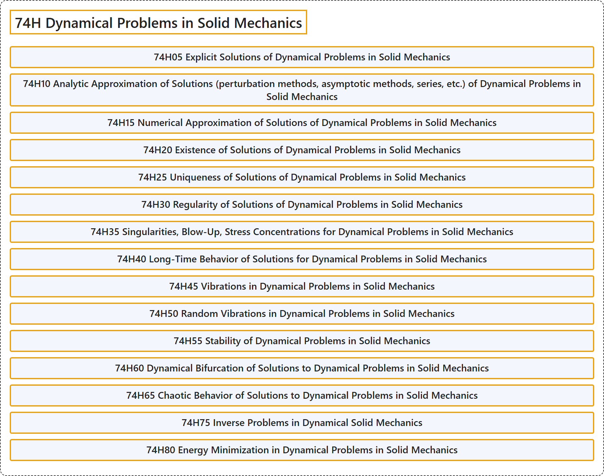

# 74H Dynamical Problems in Solid Mechanics

## Classification

## Glossary

| Term | Definition | 中文翻译 | Source |
|---|---|---|---|
| **74H Dynamical Problems in Solid Mechanics** 固体力学中的动力学问题 | (No definition) | （无定义） | [Associate Editors of Mathematical Reviews and zbMATH, 2020](https://msc2020.org/) |
| **74H05 Explicit Solutions of Dynamical Problems in Solid Mechanics** 固体力学动力学问题的显式解 | (No definition) | （无定义） | [Associate Editors of Mathematical Reviews and zbMATH, 2020](https://msc2020.org/) |
| **74H10 Analytic Approximation of Solutions (perturbation methods, asymptotic methods, series, etc.) of Dynamical Problems in Solid Mechanics** 固体力学动力学问题解的解析逼近（摄动方法、渐近方法、级数等） | (No definition) | （无定义） | [Associate Editors of Mathematical Reviews and zbMATH, 2020](https://msc2020.org/) |
| **74H15 Numerical Approximation of Solutions of Dynamical Problems in Solid Mechanics** 固体力学动力学问题解的数值逼近 | (No definition) | （无定义） | [Associate Editors of Mathematical Reviews and zbMATH, 2020](https://msc2020.org/) |
| **74H20 Existence of Solutions of Dynamical Problems in Solid Mechanics** 固体力学动力学问题解的存在性 | (No definition) | （无定义） | [Associate Editors of Mathematical Reviews and zbMATH, 2020](https://msc2020.org/) |
| **74H25 Uniqueness of Solutions of Dynamical Problems in Solid Mechanics** 固体力学动力学问题解的唯一性 | (No definition) | （无定义） | [Associate Editors of Mathematical Reviews and zbMATH, 2020](https://msc2020.org/) |
| **74H30 Regularity of Solutions of Dynamical Problems in Solid Mechanics** 固体力学动力学问题解的正则性 | (No definition) | （无定义） | [Associate Editors of Mathematical Reviews and zbMATH, 2020](https://msc2020.org/) |
| **74H35 Singularities, Blow-Up, Stress Concentrations for Dynamical Problems in Solid Mechanics** 固体力学动力学问题的奇异性、爆破、应力集中 | (No definition) | （无定义） | [Associate Editors of Mathematical Reviews and zbMATH, 2020](https://msc2020.org/) |
| **74H40 Long-Time Behavior of Solutions for Dynamical Problems in Solid Mechanics** 固体力学动力学问题解的长时间行为 | (No definition) | （无定义） | [Associate Editors of Mathematical Reviews and zbMATH, 2020](https://msc2020.org/) |
| **74H45 Vibrations in Dynamical Problems in Solid Mechanics** 固体力学动力学问题中的振动 | (No definition) | （无定义） | [Associate Editors of Mathematical Reviews and zbMATH, 2020](https://msc2020.org/) |
| **74H50 Random Vibrations in Dynamical Problems in Solid Mechanics** 固体力学动力学问题中的随机振动 | (No definition) | （无定义） | [Associate Editors of Mathematical Reviews and zbMATH, 2020](https://msc2020.org/) |
| **74H55 Stability of Dynamical Problems in Solid Mechanics** 固体力学动力学问题的稳定性 | (No definition) | （无定义） | [Associate Editors of Mathematical Reviews and zbMATH, 2020](https://msc2020.org/) |
| **74H60 Dynamical Bifurcation of Solutions to Dynamical Problems in Solid Mechanics** 固体力学动力学问题解的动力学分岔 | (No definition) | （无定义） | [Associate Editors of Mathematical Reviews and zbMATH, 2020](https://msc2020.org/) |
| **74H65 Chaotic Behavior of Solutions to Dynamical Problems in Solid Mechanics** 固体力学动力学问题解的混沌行为 | (No definition) | （无定义） | [Associate Editors of Mathematical Reviews and zbMATH, 2020](https://msc2020.org/) |
| **74H75 Inverse Problems in Dynamical Solid Mechanics** 动力学固体力学中的反问题 | (No definition) | （无定义） | [Associate Editors of Mathematical Reviews and zbMATH, 2020](https://msc2020.org/) |
| **74H80 Energy Minimization in Dynamical Problems in Solid Mechanics** 固体力学动力学问题中的能量极小化 | (No definition) | （无定义） | [Associate Editors of Mathematical Reviews and zbMATH, 2020](https://msc2020.org/) |

## References

Associate Editors of Mathematical Reviews and zbMATH. (2020). *MSC2020: Mathematics Subject Classification system*. Retrieved October 27, 2026, from <https://msc2020.org/>
