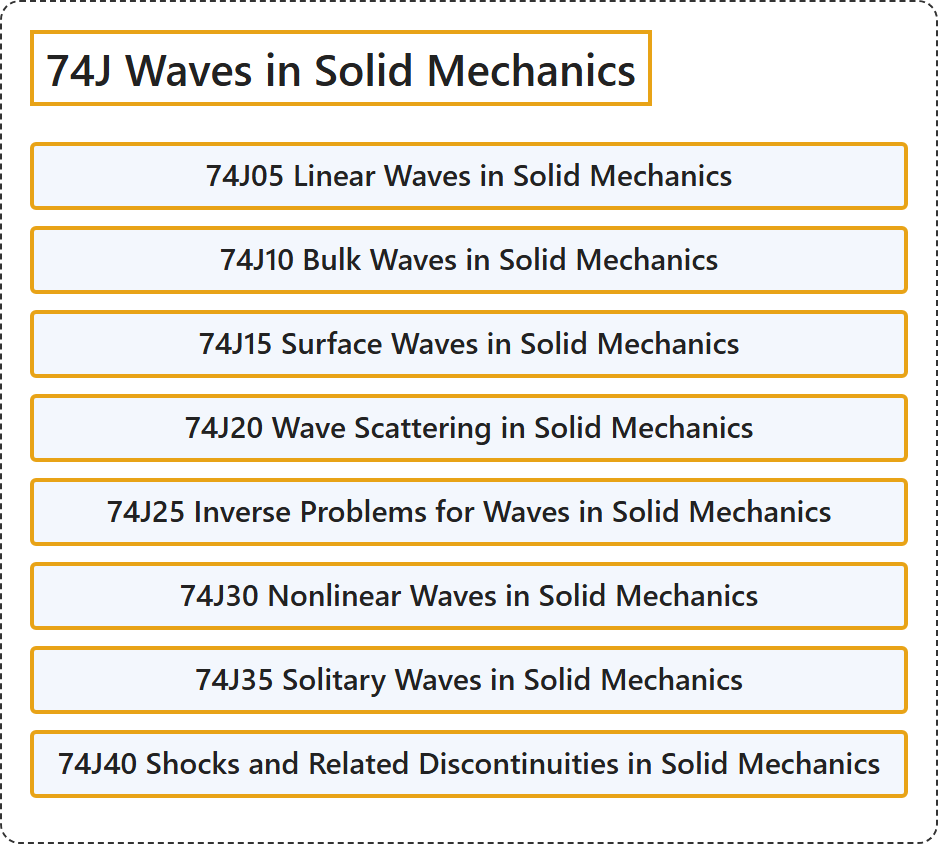

# 74J Waves in Solid Mechanics

## Classification

## Glossary

| Term | Definition | 中文翻译 | Source |
|---|---|---|---|
| **74J Waves in Solid Mechanics** 固体力学中的波 | (No definition) | （无定义） | [Associate Editors of Mathematical Reviews and zbMATH, 2020](https://msc2020.org/) |
| **74J05 Linear Waves in Solid Mechanics** 固体力学中的线性波 | (No definition) | （无定义） | [Associate Editors of Mathematical Reviews and zbMATH, 2020](https://msc2020.org/) |
| **74J10 Bulk Waves in Solid Mechanics** 固体力学中的体波 | (No definition) | （无定义） | [Associate Editors of Mathematical Reviews and zbMATH, 2020](https://msc2020.org/) |
| **74J15 Surface Waves in Solid Mechanics** 固体力学中的表面波 | (No definition) | （无定义） | [Associate Editors of Mathematical Reviews and zbMATH, 2020](https://msc2020.org/) |
| **74J20 Wave Scattering in Solid Mechanics** 固体力学中的波散射 | (No definition) | （无定义） | [Associate Editors of Mathematical Reviews and zbMATH, 2020](https://msc2020.org/) |
| **74J25 Inverse Problems for Waves in Solid Mechanics** 固体力学中波的反问题 | (No definition) | （无定义） | [Associate Editors of Mathematical Reviews and zbMATH, 2020](https://msc2020.org/) |
| **74J30 Nonlinear Waves in Solid Mechanics** 固体力学中的非线性波 | (No definition) | （无定义） | [Associate Editors of Mathematical Reviews and zbMATH, 2020](https://msc2020.org/) |
| **74J35 Solitary Waves in Solid Mechanics** 固体力学中的孤立波 | (No definition) | （无定义） | [Associate Editors of Mathematical Reviews and zbMATH, 2020](https://msc2020.org/) |
| **74J40 Shocks and Related Discontinuities in Solid Mechanics** 固体力学中的激波及相关间断 | (No definition) | （无定义） | [Associate Editors of Mathematical Reviews and zbMATH, 2020](https://msc2020.org/) |

## References

Associate Editors of Mathematical Reviews and zbMATH. (2020). *MSC2020: Mathematics Subject Classification system*. Retrieved October 27, 2026, from <https://msc2020.org/>
