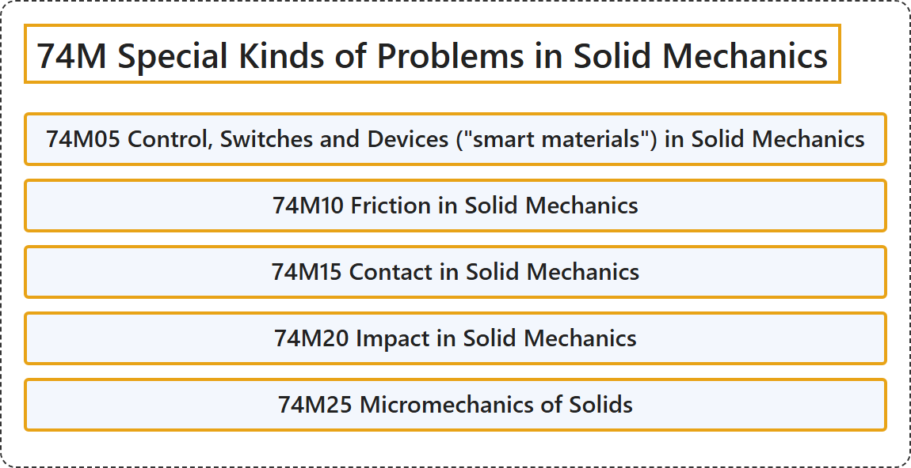

# 74M Special Kinds of Problems in Solid Mechanics

## Classification

## Glossary

| Term | Definition | 中文翻译 | Source |
|---|---|---|---|
| **74M Special Kinds of Problems in Solid Mechanics** 固体力学中的特殊类型问题 | (No definition) | （无定义） | [Associate Editors of Mathematical Reviews and zbMATH, 2020](https://msc2020.org/) |
| **74M05 Control, Switches and Devices ("smart materials") in Solid Mechanics** 固体力学中的控制、开关与装置（“智能材料”） | (No definition) | （无定义） | [Associate Editors of Mathematical Reviews and zbMATH, 2020](https://msc2020.org/) |
| **74M10 Friction in Solid Mechanics** 固体力学中的摩擦 | (No definition) | （无定义） | [Associate Editors of Mathematical Reviews and zbMATH, 2020](https://msc2020.org/) |
| **74M15 Contact in Solid Mechanics** 固体力学中的接触 | (No definition) | （无定义） | [Associate Editors of Mathematical Reviews and zbMATH, 2020](https://msc2020.org/) |
| **74M20 Impact in Solid Mechanics** 固体力学中的冲击 | (No definition) | （无定义） | [Associate Editors of Mathematical Reviews and zbMATH, 2020](https://msc2020.org/) |
| **74M25 Micromechanics of Solids** 固体微观力学 | (No definition) | （无定义） | [Associate Editors of Mathematical Reviews and zbMATH, 2020](https://msc2020.org/) |

## References

Associate Editors of Mathematical Reviews and zbMATH. (2020). *MSC2020: Mathematics Subject Classification system*. Retrieved October 27, 2026, from <https://msc2020.org/>
