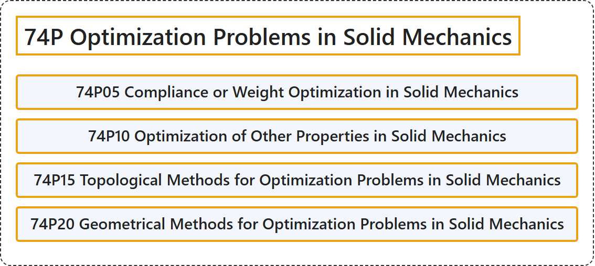

# 74P Optimization Problems in Solid Mechanics

## Classification

## Glossary

| Term | Definition | 中文翻译 | Source |
|---|---|---|---|
| **74P Optimization Problems in Solid Mechanics** 固体力学中的最优化问题 | (No definition) | （无定义） | [Associate Editors of Mathematical Reviews and zbMATH, 2020](https://msc2020.org/) |
| **74P05 Compliance or Weight Optimization in Solid Mechanics** 固体力学中的柔度或重量优化 | (No definition) | （无定义） | [Associate Editors of Mathematical Reviews and zbMATH, 2020](https://msc2020.org/) |
| **74P10 Optimization of Other Properties in Solid Mechanics** 固体力学中其他性质的优化 | (No definition) | （无定义） | [Associate Editors of Mathematical Reviews and zbMATH, 2020](https://msc2020.org/) |
| **74P15 Topological Methods for Optimization Problems in Solid Mechanics** 固体力学优化问题的拓扑方法 | (No definition) | （无定义） | [Associate Editors of Mathematical Reviews and zbMATH, 2020](https://msc2020.org/) |
| **74P20 Geometrical Methods for Optimization Problems in Solid Mechanics** 固体力学优化问题的几何方法 | (No definition) | （无定义） | [Associate Editors of Mathematical Reviews and zbMATH, 2020](https://msc2020.org/) |

## References

Associate Editors of Mathematical Reviews and zbMATH. (2020). *MSC2020: Mathematics Subject Classification system*. Retrieved October 27, 2026, from <https://msc2020.org/>
