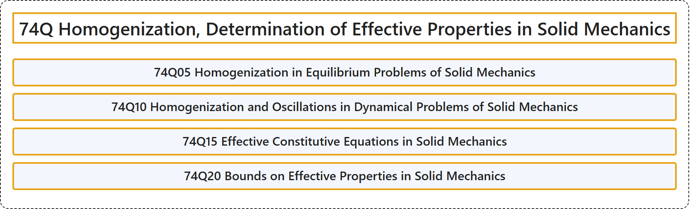

# 74Q Homogenization, Determination of Effective Properties in Solid Mechanics

## Classification

## Glossary

| Term | Definition | 中文翻译 | Source |
|---|---|---|---|
| **74Q Homogenization, Determination of Effective Properties in Solid Mechanics** 固体力学中的均匀化、有效性质的确定 | (No definition) | （无定义） | [Associate Editors of Mathematical Reviews and zbMATH, 2020](https://msc2020.org/) |
| **74Q05 Homogenization in Equilibrium Problems of Solid Mechanics** 固体力学平衡问题中的均匀化 | (No definition) | （无定义） | [Associate Editors of Mathematical Reviews and zbMATH, 2020](https://msc2020.org/) |
| **74Q10 Homogenization and Oscillations in Dynamical Problems of Solid Mechanics** 固体力学动力学问题中的均匀化与振荡 | (No definition) | （无定义） | [Associate Editors of Mathematical Reviews and zbMATH, 2020](https://msc2020.org/) |
| **74Q15 Effective Constitutive Equations in Solid Mechanics** 固体力学中的有效本构方程 | (No definition) | （无定义） | [Associate Editors of Mathematical Reviews and zbMATH, 2020](https://msc2020.org/) |
| **74Q20 Bounds on Effective Properties in Solid Mechanics** 固体力学中有效性质的界 | (No definition) | （无定义） | [Associate Editors of Mathematical Reviews and zbMATH, 2020](https://msc2020.org/) |

## References

Associate Editors of Mathematical Reviews and zbMATH. (2020). *MSC2020: Mathematics Subject Classification system*. Retrieved October 27, 2026, from <https://msc2020.org/>
