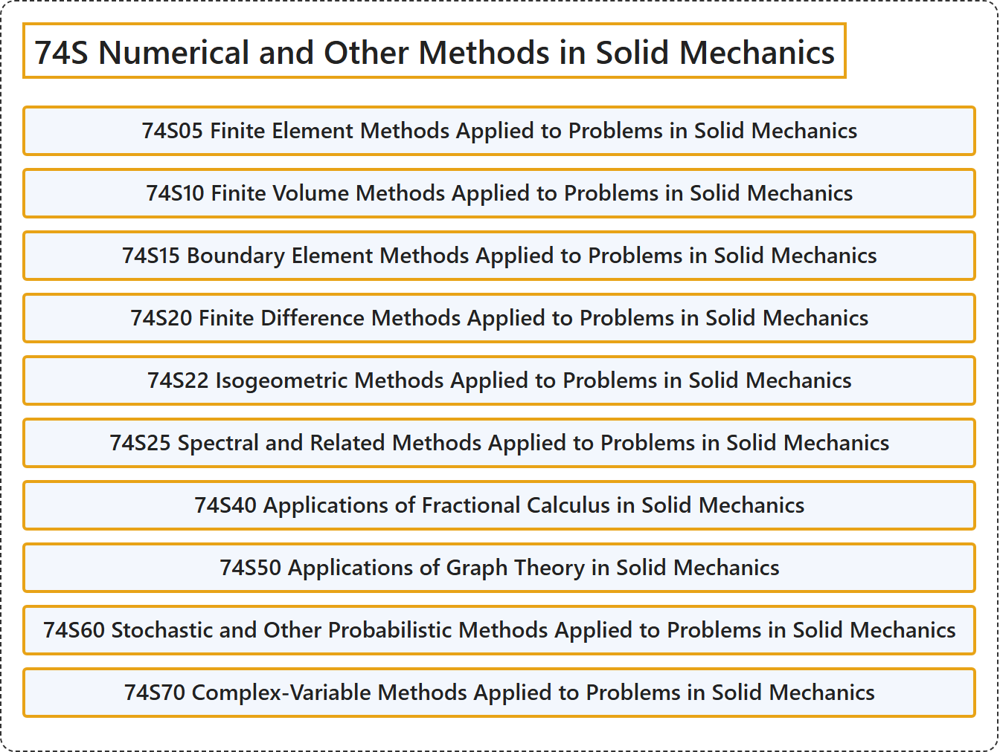

# 74S Numerical and Other Methods in Solid Mechanics

## Classification

## Glossary

| Term | Definition | 中文翻译 | Source |
|---|---|---|---|
| **74S Numerical and Other Methods in Solid Mechanics** 固体力学中的数值及其他方法 | (No definition) | （无定义） | [Associate Editors of Mathematical Reviews and zbMATH, 2020](https://msc2020.org/) |
| **74S05 Finite Element Methods Applied to Problems in Solid Mechanics** 应用于固体力学问题的有限元方法 | (No definition) | （无定义） | [Associate Editors of Mathematical Reviews and zbMATH, 2020](https://msc2020.org/) |
| **74S10 Finite Volume Methods Applied to Problems in Solid Mechanics** 应用于固体力学问题的有限体积方法 | (No definition) | （无定义） | [Associate Editors of Mathematical Reviews and zbMATH, 2020](https://msc2020.org/) |
| **74S15 Boundary Element Methods Applied to Problems in Solid Mechanics** 应用于固体力学问题的边界元方法 | (No definition) | （无定义） | [Associate Editors of Mathematical Reviews and zbMATH, 2020](https://msc2020.org/) |
| **74S20 Finite Difference Methods Applied to Problems in Solid Mechanics** 应用于固体力学问题的有限差分方法 | (No definition) | （无定义） | [Associate Editors of Mathematical Reviews and zbMATH, 2020](https://msc2020.org/) |
| **74S22 Isogeometric Methods Applied to Problems in Solid Mechanics** 应用于固体力学问题的等几何方法 | (No definition) | （无定义） | [Associate Editors of Mathematical Reviews and zbMATH, 2020](https://msc2020.org/) |
| **74S25 Spectral and Related Methods Applied to Problems in Solid Mechanics** 应用于固体力学问题的谱方法及相关方法 | (No definition) | （无定义） | [Associate Editors of Mathematical Reviews and zbMATH, 2020](https://msc2020.org/) |
| **74S40 Applications of Fractional Calculus in Solid Mechanics** 分数阶微积分在固体力学中的应用 | (No definition) | （无定义） | [Associate Editors of Mathematical Reviews and zbMATH, 2020](https://msc2020.org/) |
| **74S50 Applications of Graph Theory in Solid Mechanics** 图论在固体力学中的应用 | (No definition) | （无定义） | [Associate Editors of Mathematical Reviews and zbMATH, 2020](https://msc2020.org/) |
| **74S60 Stochastic and Other Probabilistic Methods Applied to Problems in Solid Mechanics** 应用于固体力学问题的随机方法及其他概率方法 | (No definition) | （无定义） | [Associate Editors of Mathematical Reviews and zbMATH, 2020](https://msc2020.org/) |
| **74S70 Complex-Variable Methods Applied to Problems in Solid Mechanics** 应用于固体力学问题的复变方法 | (No definition) | （无定义） | [Associate Editors of Mathematical Reviews and zbMATH, 2020](https://msc2020.org/) |

## References

Associate Editors of Mathematical Reviews and zbMATH. (2020). *MSC2020: Mathematics Subject Classification system*. Retrieved October 27, 2026, from <https://msc2020.org/>
