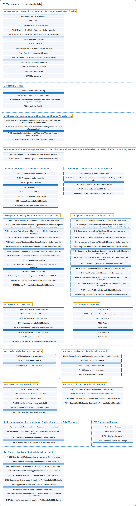

# 74 Mechanics of Deformable Solids

## Classification

## Glossary

| Term | Definition | 中文翻译 | Source |
|---|---|---|---|
| **74 Mechanics of Deformable Solids** 可变形固体力学 | (Definition pending: no web source yet.) | （定义待补：暂无网页来源。） | Pending |
| **[74A Generalities, Axiomatics, Foundations of Continuum Mechanics of Solids](74a-generalities-axiomatics-foundations-of-continuum-mechanics-o.md)** 固体连续介质力学的一般性、公理化与基础 | (No definition) | （无定义） | [Associate Editors of Mathematical Reviews and zbMATH, 2020](https://msc2020.org/) |
| **[74B Elastic Materials](74b-elastic-materials.md)** 弹性材料 | (No definition) | （无定义） | [Associate Editors of Mathematical Reviews and zbMATH, 2020](https://msc2020.org/) |
| **[74C Plastic Materials, Materials of Stress-Rate and Internal-Variable Type](74c-plastic-materials-materials-of-stress-rate-and-internal-vari.md)** 塑性材料、应力率型与内变量型材料 | (No definition) | （无定义） | [Associate Editors of Mathematical Reviews and zbMATH, 2020](https://msc2020.org/) |
| **[74D Materials of Strain-Rate Type and History Type, Other Materials with Memory (including elastic materials with viscous damping, various viscoelastic materials)](74d-materials-of-strain-rate-type-and-history-type-other-materia.md)** 应变率型与历史型材料、其他记忆材料（包括带粘性阻尼的弹性材料、各种粘弹性材料） | (No definition) | （无定义） | [Associate Editors of Mathematical Reviews and zbMATH, 2020](https://msc2020.org/) |
| **[74E Material Properties Given Special Treatment](74e-material-properties-given-special-treatment.md)** 受特殊处理的材料性质 | (No definition) | （无定义） | [Associate Editors of Mathematical Reviews and zbMATH, 2020](https://msc2020.org/) |
| **[74F Coupling of Solid Mechanics with Other Effects](74f-coupling-of-solid-mechanics-with-other-effects.md)** 固体力学与其他效应的耦合 | (No definition) | （无定义） | [Associate Editors of Mathematical Reviews and zbMATH, 2020](https://msc2020.org/) |
| **[74G Equilibrium (steady-state) Problems in Solid Mechanics](74g-equilibrium-steady-state-problems-in-solid-mechanics.md)** 固体力学中的平衡（定常）问题 | (No definition) | （无定义） | [Associate Editors of Mathematical Reviews and zbMATH, 2020](https://msc2020.org/) |
| **[74H Dynamical Problems in Solid Mechanics](74h-dynamical-problems-in-solid-mechanics.md)** 固体力学中的动力学问题 | (No definition) | （无定义） | [Associate Editors of Mathematical Reviews and zbMATH, 2020](https://msc2020.org/) |
| **[74J Waves in Solid Mechanics](74j-waves-in-solid-mechanics.md)** 固体力学中的波 | (No definition) | （无定义） | [Associate Editors of Mathematical Reviews and zbMATH, 2020](https://msc2020.org/) |
| **[74K Thin Bodies, Structures](74k-thin-bodies-structures.md)** 薄体、结构 | (No definition) | （无定义） | [Associate Editors of Mathematical Reviews and zbMATH, 2020](https://msc2020.org/) |
| **[74L Special Subfields of Solid Mechanics](74l-special-subfields-of-solid-mechanics.md)** 固体力学的特殊分支 | (No definition) | （无定义） | [Associate Editors of Mathematical Reviews and zbMATH, 2020](https://msc2020.org/) |
| **[74M Special Kinds of Problems in Solid Mechanics](74m-special-kinds-of-problems-in-solid-mechanics.md)** 固体力学中的特殊类型问题 | (No definition) | （无定义） | [Associate Editors of Mathematical Reviews and zbMATH, 2020](https://msc2020.org/) |
| **[74N Phase Transformations in Solids](74n-phase-transformations-in-solids.md)** 固体中的相变 | (No definition) | （无定义） | [Associate Editors of Mathematical Reviews and zbMATH, 2020](https://msc2020.org/) |
| **[74P Optimization Problems in Solid Mechanics](74p-optimization-problems-in-solid-mechanics.md)** 固体力学中的最优化问题 | (No definition) | （无定义） | [Associate Editors of Mathematical Reviews and zbMATH, 2020](https://msc2020.org/) |
| **[74Q Homogenization, Determination of Effective Properties in Solid Mechanics](74q-homogenization-determination-of-effective-properties-in-soli.md)** 固体力学中的均匀化、有效性质的确定 | (No definition) | （无定义） | [Associate Editors of Mathematical Reviews and zbMATH, 2020](https://msc2020.org/) |
| **[74R Fracture and Damage](74r-fracture-and-damage.md)** 断裂与损伤 | (No definition) | （无定义） | [Associate Editors of Mathematical Reviews and zbMATH, 2020](https://msc2020.org/) |
| **[74S Numerical and Other Methods in Solid Mechanics](74s-numerical-and-other-methods-in-solid-mechanics.md)** 固体力学中的数值及其他方法 | (No definition) | （无定义） | [Associate Editors of Mathematical Reviews and zbMATH, 2020](https://msc2020.org/) |

## References

Associate Editors of Mathematical Reviews and zbMATH. (2020). *MSC2020: Mathematics Subject Classification system*. Retrieved October 27, 2026, from <https://msc2020.org/>
