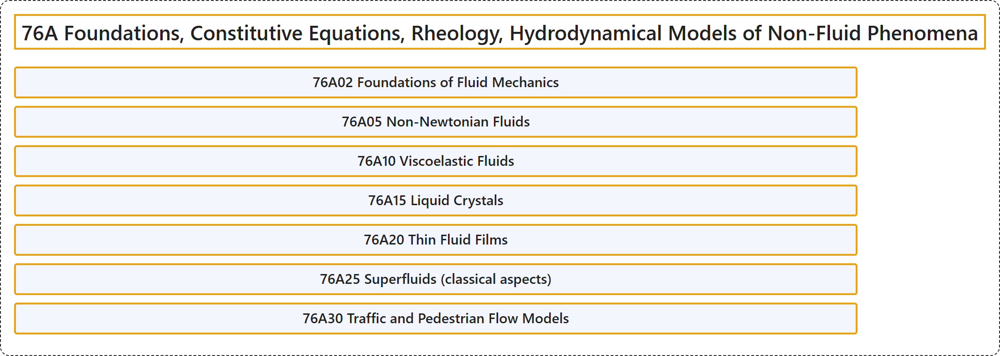

# 76A Foundations, Constitutive Equations, Rheology, Hydrodynamical Models of Non-Fluid Phenomena

## Classification

## Glossary

| Term | Definition | 中文翻译 | Source |
|---|---|---|---|
| **76A Foundations, Constitutive Equations, Rheology, Hydrodynamical Models of Non-Fluid Phenomena** 基础、本构方程、流变学、非流体现象的流体动力学模型 | (No definition) | （无定义） | [Associate Editors of Mathematical Reviews and zbMATH, 2020](https://msc2020.org/) |
| **76A02 Foundations of Fluid Mechanics** 流体力学基础 | (No definition) | （无定义） | [Associate Editors of Mathematical Reviews and zbMATH, 2020](https://msc2020.org/) |
| **76A05 Non-Newtonian Fluids** 非牛顿流体 | (No definition) | （无定义） | [Associate Editors of Mathematical Reviews and zbMATH, 2020](https://msc2020.org/) |
| **76A10 Viscoelastic Fluids** 黏弹性流体 | (No definition) | （无定义） | [Associate Editors of Mathematical Reviews and zbMATH, 2020](https://msc2020.org/) |
| **76A15 Liquid Crystals** 液晶 | (No definition) | （无定义） | [Associate Editors of Mathematical Reviews and zbMATH, 2020](https://msc2020.org/) |
| **76A20 Thin Fluid Films** 薄流体膜 | (No definition) | （无定义） | [Associate Editors of Mathematical Reviews and zbMATH, 2020](https://msc2020.org/) |
| **76A25 Superfluids (classical aspects)** 超流体（经典方面） | (No definition) | （无定义） | [Associate Editors of Mathematical Reviews and zbMATH, 2020](https://msc2020.org/) |
| **76A30 Traffic and Pedestrian Flow Models** 交通流与行人流模型 | (No definition) | （无定义） | [Associate Editors of Mathematical Reviews and zbMATH, 2020](https://msc2020.org/) |

## References

Associate Editors of Mathematical Reviews and zbMATH. (2020). *MSC2020: Mathematics Subject Classification system*. Retrieved October 27, 2026, from <https://msc2020.org/>
