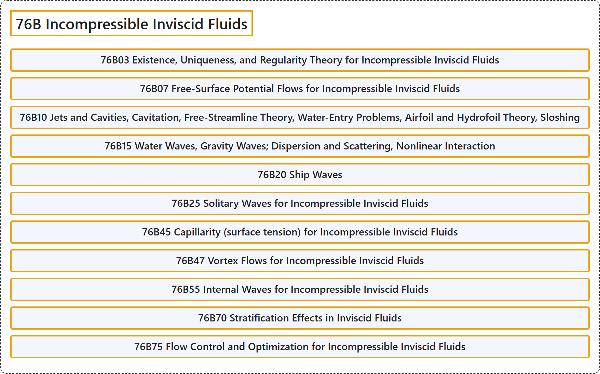

# 76B Incompressible Inviscid Fluids

## Classification

## Glossary

| Term | Definition | 中文翻译 | Source |
|---|---|---|---|
| **76B Incompressible Inviscid Fluids** 不可压缩无粘流体 | (No definition) | （无定义） | [Associate Editors of Mathematical Reviews and zbMATH, 2020](https://msc2020.org/) |
| **76B03 Existence, Uniqueness, and Regularity Theory for Incompressible Inviscid Fluids** 不可压缩无黏流体的存在性、唯一性与正则性理论 | (No definition) | （无定义） | [Associate Editors of Mathematical Reviews and zbMATH, 2020](https://msc2020.org/) |
| **76B07 Free-Surface Potential Flows for Incompressible Inviscid Fluids** 不可压缩无黏流体的自由表面势流 | (No definition) | （无定义） | [Associate Editors of Mathematical Reviews and zbMATH, 2020](https://msc2020.org/) |
| **76B10 Jets and Cavities, Cavitation, Free-Streamline Theory, Water-Entry Problems, Airfoil and Hydrofoil Theory, Sloshing** 射流与空泡、空化、自由流线理论、入水问题、翼型与水翼理论、晃动 | (No definition) | （无定义） | [Associate Editors of Mathematical Reviews and zbMATH, 2020](https://msc2020.org/) |
| **76B15 Water Waves, Gravity Waves; Dispersion and Scattering, Nonlinear Interaction** 水波、重力波；色散与散射、非线性相互作用 | (No definition) | （无定义） | [Associate Editors of Mathematical Reviews and zbMATH, 2020](https://msc2020.org/) |
| **76B20 Ship Waves** 船波 | (No definition) | （无定义） | [Associate Editors of Mathematical Reviews and zbMATH, 2020](https://msc2020.org/) |
| **76B25 Solitary Waves for Incompressible Inviscid Fluids** 不可压缩无黏流体的孤立波 | (No definition) | （无定义） | [Associate Editors of Mathematical Reviews and zbMATH, 2020](https://msc2020.org/) |
| **76B45 Capillarity (surface tension) for Incompressible Inviscid Fluids** 不可压缩无黏流体的毛细现象（表面张力） | (No definition) | （无定义） | [Associate Editors of Mathematical Reviews and zbMATH, 2020](https://msc2020.org/) |
| **76B47 Vortex Flows for Incompressible Inviscid Fluids** 不可压缩无黏流体的涡旋流 | (No definition) | （无定义） | [Associate Editors of Mathematical Reviews and zbMATH, 2020](https://msc2020.org/) |
| **76B55 Internal Waves for Incompressible Inviscid Fluids** 不可压缩无黏流体的内波 | (No definition) | （无定义） | [Associate Editors of Mathematical Reviews and zbMATH, 2020](https://msc2020.org/) |
| **76B70 Stratification Effects in Inviscid Fluids** 无黏流体中的分层效应 | (No definition) | （无定义） | [Associate Editors of Mathematical Reviews and zbMATH, 2020](https://msc2020.org/) |
| **76B75 Flow Control and Optimization for Incompressible Inviscid Fluids** 不可压缩无黏流体的流动控制与优化 | (No definition) | （无定义） | [Associate Editors of Mathematical Reviews and zbMATH, 2020](https://msc2020.org/) |

## References

Associate Editors of Mathematical Reviews and zbMATH. (2020). *MSC2020: Mathematics Subject Classification system*. Retrieved October 27, 2026, from <https://msc2020.org/>
