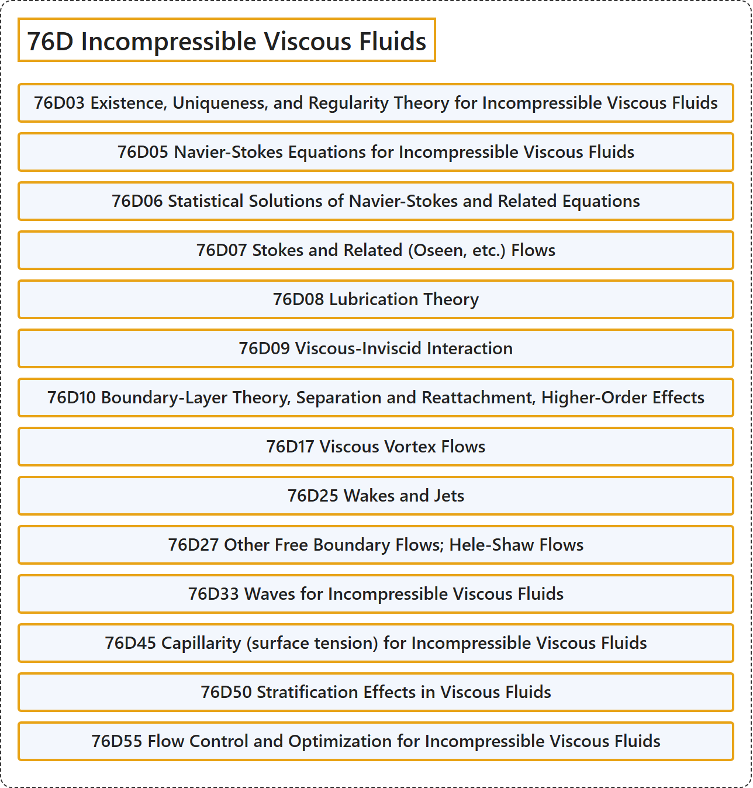

# 76D Incompressible Viscous Fluids

## Classification

## Glossary

| Term | Definition | 中文翻译 | Source |
|---|---|---|---|
| **76D Incompressible Viscous Fluids** 不可压缩粘性流体 | (No definition) | （无定义） | [Associate Editors of Mathematical Reviews and zbMATH, 2020](https://msc2020.org/) |
| **76D03 Existence, Uniqueness, and Regularity Theory for Incompressible Viscous Fluids** 不可压缩黏性流体的存在性、唯一性与正则性理论 | (No definition) | （无定义） | [Associate Editors of Mathematical Reviews and zbMATH, 2020](https://msc2020.org/) |
| **76D05 Navier-Stokes Equations for Incompressible Viscous Fluids** 不可压缩黏性流体的纳维-斯托克斯方程 | (No definition) | （无定义） | [Associate Editors of Mathematical Reviews and zbMATH, 2020](https://msc2020.org/) |
| **76D06 Statistical Solutions of Navier-Stokes and Related Equations** 纳维-斯托克斯方程及相关方程的统计解 | (No definition) | （无定义） | [Associate Editors of Mathematical Reviews and zbMATH, 2020](https://msc2020.org/) |
| **76D07 Stokes and Related (Oseen, etc.) Flows** 斯托克斯流及相关（奥辛等）流动 | (No definition) | （无定义） | [Associate Editors of Mathematical Reviews and zbMATH, 2020](https://msc2020.org/) |
| **76D08 Lubrication Theory** 润滑理论 | (No definition) | （无定义） | [Associate Editors of Mathematical Reviews and zbMATH, 2020](https://msc2020.org/) |
| **76D09 Viscous-Inviscid Interaction** 黏性-无黏相互作用 | (No definition) | （无定义） | [Associate Editors of Mathematical Reviews and zbMATH, 2020](https://msc2020.org/) |
| **76D10 Boundary-Layer Theory, Separation and Reattachment, Higher-Order Effects** 边界层理论、分离与再附、高阶效应 | (No definition) | （无定义） | [Associate Editors of Mathematical Reviews and zbMATH, 2020](https://msc2020.org/) |
| **76D17 Viscous Vortex Flows** 黏性涡旋流 | (No definition) | （无定义） | [Associate Editors of Mathematical Reviews and zbMATH, 2020](https://msc2020.org/) |
| **76D25 Wakes and Jets** 尾流与射流 | (No definition) | （无定义） | [Associate Editors of Mathematical Reviews and zbMATH, 2020](https://msc2020.org/) |
| **76D27 Other Free Boundary Flows; Hele-Shaw Flows** 其他自由边界流；赫尔-肖流 | (No definition) | （无定义） | [Associate Editors of Mathematical Reviews and zbMATH, 2020](https://msc2020.org/) |
| **76D33 Waves for Incompressible Viscous Fluids** 不可压缩黏性流体的波 | (No definition) | （无定义） | [Associate Editors of Mathematical Reviews and zbMATH, 2020](https://msc2020.org/) |
| **76D45 Capillarity (surface tension) for Incompressible Viscous Fluids** 不可压缩黏性流体的毛细现象（表面张力） | (No definition) | （无定义） | [Associate Editors of Mathematical Reviews and zbMATH, 2020](https://msc2020.org/) |
| **76D50 Stratification Effects in Viscous Fluids** 黏性流体中的分层效应 | (No definition) | （无定义） | [Associate Editors of Mathematical Reviews and zbMATH, 2020](https://msc2020.org/) |
| **76D55 Flow Control and Optimization for Incompressible Viscous Fluids** 不可压缩黏性流体的流动控制与优化 | (No definition) | （无定义） | [Associate Editors of Mathematical Reviews and zbMATH, 2020](https://msc2020.org/) |

## References

Associate Editors of Mathematical Reviews and zbMATH. (2020). *MSC2020: Mathematics Subject Classification system*. Retrieved October 27, 2026, from <https://msc2020.org/>
