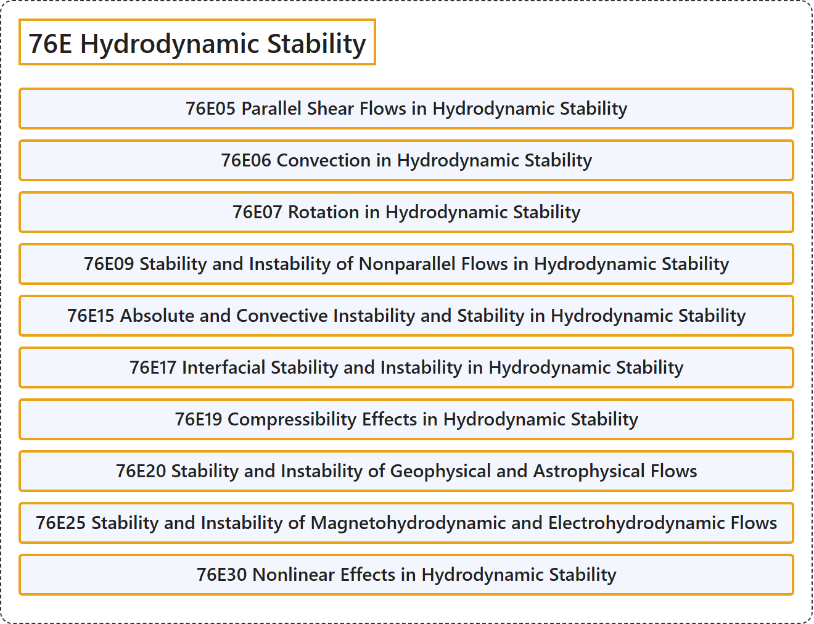

# 76E Hydrodynamic Stability

## Classification

## Glossary

| Term | Definition | 中文翻译 | Source |
|---|---|---|---|
| **76E Hydrodynamic Stability** 流体动力稳定性 | (No definition) | （无定义） | [Associate Editors of Mathematical Reviews and zbMATH, 2020](https://msc2020.org/) |
| **76E05 Parallel Shear Flows in Hydrodynamic Stability** 流体动力学稳定性中的平行剪切流 | (No definition) | （无定义） | [Associate Editors of Mathematical Reviews and zbMATH, 2020](https://msc2020.org/) |
| **76E06 Convection in Hydrodynamic Stability** 流体动力学稳定性中的对流 | (No definition) | （无定义） | [Associate Editors of Mathematical Reviews and zbMATH, 2020](https://msc2020.org/) |
| **76E07 Rotation in Hydrodynamic Stability** 流体动力学稳定性中的旋转 | (No definition) | （无定义） | [Associate Editors of Mathematical Reviews and zbMATH, 2020](https://msc2020.org/) |
| **76E09 Stability and Instability of Nonparallel Flows in Hydrodynamic Stability** 流体动力学稳定性中非平行流的稳定性与不稳定性 | (No definition) | （无定义） | [Associate Editors of Mathematical Reviews and zbMATH, 2020](https://msc2020.org/) |
| **76E15 Absolute and Convective Instability and Stability in Hydrodynamic Stability** 流体动力学稳定性中的绝对与对流不稳定性及稳定性 | (No definition) | （无定义） | [Associate Editors of Mathematical Reviews and zbMATH, 2020](https://msc2020.org/) |
| **76E17 Interfacial Stability and Instability in Hydrodynamic Stability** 流体动力学稳定性中的界面稳定性与不稳定性 | (No definition) | （无定义） | [Associate Editors of Mathematical Reviews and zbMATH, 2020](https://msc2020.org/) |
| **76E19 Compressibility Effects in Hydrodynamic Stability** 流体动力学稳定性中的可压缩性效应 | (No definition) | （无定义） | [Associate Editors of Mathematical Reviews and zbMATH, 2020](https://msc2020.org/) |
| **76E20 Stability and Instability of Geophysical and Astrophysical Flows** 地球物理与天体物理流动的稳定性与不稳定性 | (No definition) | （无定义） | [Associate Editors of Mathematical Reviews and zbMATH, 2020](https://msc2020.org/) |
| **76E25 Stability and Instability of Magnetohydrodynamic and Electrohydrodynamic Flows** 磁流体与电流体动力学流动的稳定性与不稳定性 | (No definition) | （无定义） | [Associate Editors of Mathematical Reviews and zbMATH, 2020](https://msc2020.org/) |
| **76E30 Nonlinear Effects in Hydrodynamic Stability** 流体动力学稳定性中的非线性效应 | (No definition) | （无定义） | [Associate Editors of Mathematical Reviews and zbMATH, 2020](https://msc2020.org/) |

## References

Associate Editors of Mathematical Reviews and zbMATH. (2020). *MSC2020: Mathematics Subject Classification system*. Retrieved October 27, 2026, from <https://msc2020.org/>
