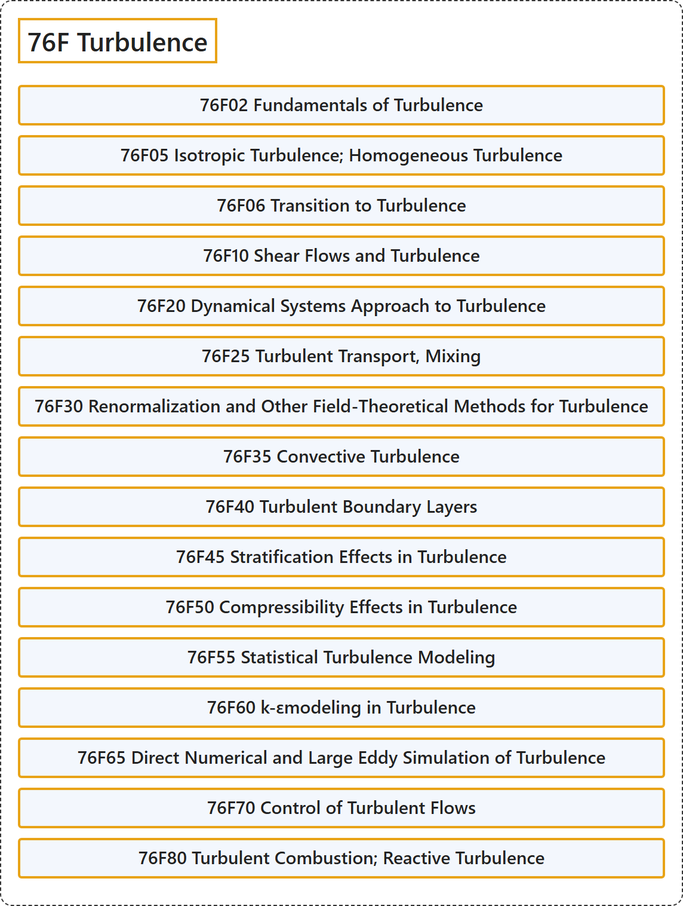

# 76F Turbulence

## Classification

## Glossary

| Term | Definition | 中文翻译 | Source |
|---|---|---|---|
| **76F Turbulence** 湍流 | (No definition) | （无定义） | [Associate Editors of Mathematical Reviews and zbMATH, 2020](https://msc2020.org/) |
| **76F02 Fundamentals of Turbulence** 湍流基础 | (No definition) | （无定义） | [Associate Editors of Mathematical Reviews and zbMATH, 2020](https://msc2020.org/) |
| **76F05 Isotropic Turbulence; Homogeneous Turbulence** 各向同性湍流；均匀湍流 | (No definition) | （无定义） | [Associate Editors of Mathematical Reviews and zbMATH, 2020](https://msc2020.org/) |
| **76F06 Transition to Turbulence** 向湍流的转捩 | (No definition) | （无定义） | [Associate Editors of Mathematical Reviews and zbMATH, 2020](https://msc2020.org/) |
| **76F10 Shear Flows and Turbulence** 剪切流与湍流 | (No definition) | （无定义） | [Associate Editors of Mathematical Reviews and zbMATH, 2020](https://msc2020.org/) |
| **76F20 Dynamical Systems Approach to Turbulence** 湍流的动力系统方法 | (No definition) | （无定义） | [Associate Editors of Mathematical Reviews and zbMATH, 2020](https://msc2020.org/) |
| **76F25 Turbulent Transport, Mixing** 湍流输运、混合 | (No definition) | （无定义） | [Associate Editors of Mathematical Reviews and zbMATH, 2020](https://msc2020.org/) |
| **76F30 Renormalization and Other Field-Theoretical Methods for Turbulence** 湍流的重整化及其他场论方法 | (No definition) | （无定义） | [Associate Editors of Mathematical Reviews and zbMATH, 2020](https://msc2020.org/) |
| **76F35 Convective Turbulence** 对流湍流 | (No definition) | （无定义） | [Associate Editors of Mathematical Reviews and zbMATH, 2020](https://msc2020.org/) |
| **76F40 Turbulent Boundary Layers** 湍流边界层 | (No definition) | （无定义） | [Associate Editors of Mathematical Reviews and zbMATH, 2020](https://msc2020.org/) |
| **76F45 Stratification Effects in Turbulence** 湍流中的分层效应 | (No definition) | （无定义） | [Associate Editors of Mathematical Reviews and zbMATH, 2020](https://msc2020.org/) |
| **76F50 Compressibility Effects in Turbulence** 湍流中的可压缩性效应 | (No definition) | （无定义） | [Associate Editors of Mathematical Reviews and zbMATH, 2020](https://msc2020.org/) |
| **76F55 Statistical Turbulence Modeling** 统计湍流模型 | (No definition) | （无定义） | [Associate Editors of Mathematical Reviews and zbMATH, 2020](https://msc2020.org/) |
| **76F60 k-εmodeling in Turbulence** 湍流中的 k-ε 模型 | (No definition) | （无定义） | [Associate Editors of Mathematical Reviews and zbMATH, 2020](https://msc2020.org/) |
| **76F65 Direct Numerical and Large Eddy Simulation of Turbulence** 湍流的直接数值模拟与大涡模拟 | (No definition) | （无定义） | [Associate Editors of Mathematical Reviews and zbMATH, 2020](https://msc2020.org/) |
| **76F70 Control of Turbulent Flows** 湍流的控制 | (No definition) | （无定义） | [Associate Editors of Mathematical Reviews and zbMATH, 2020](https://msc2020.org/) |
| **76F80 Turbulent Combustion; Reactive Turbulence** 湍流燃烧；反应湍流 | (No definition) | （无定义） | [Associate Editors of Mathematical Reviews and zbMATH, 2020](https://msc2020.org/) |

## References

Associate Editors of Mathematical Reviews and zbMATH. (2020). *MSC2020: Mathematics Subject Classification system*. Retrieved October 27, 2026, from <https://msc2020.org/>
